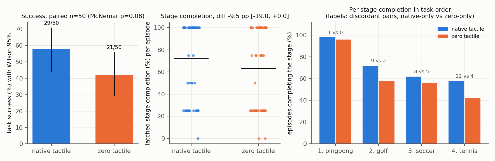

# CLOSED_LOOP_RESULTS — 폐루프 결과(작업 27, Isaac Sim 6.2 이식)

작성 2026-11-24. 모든 수치는 이 기계에서 측정했다.
- 사전 등록은 NOTES에 있다: 조건과 검정 23:55, N = 50 00:08, 렌더링 수정 후 재시작 00:27.
- 4절의 실패 분석은 사전 등록 범위(단계 완료, 촉각 접촉 기록)를 넘는 기술 통계다.

## 요약

- 촉각을 0으로 지우자 작업 성공률이 **58%(29/50)에서 42%(21/50)로 16%p** 떨어졌다. 짝 bootstrap 95% 구간은 [−30, −2]%p다.
- 그러나 사전 등록한 주 검정(짝 exact McNemar)은 **p = 0.077**로, 5% 수준에서 유의하지 않다. 결과가 엇갈린 16쌍 가운데 12쌍은 native만, 4쌍은 zero만 성공했다.
- 단계 완료율(LSCR)은 72.5%에서 63.0%로 −9.5%p [−19.0, 0.0]다.
- 촉각을 지운 쪽도 물체를 만지는 양과 횟수가 같고, 떨어뜨림과 grasp 품질 지표도 같다. 차이는 둘째 단계(골프공)와 마지막 단계(테니스공)에 몰려 있다.
- 판단:
  - 이 정책은 폐루프에서 촉각을 쓰는 것으로 보인다. 방향은 일관되지만 통계 근거는 중간이다.
  - 오프라인에서 본 호출당 영향(seed noise의 5%)보다 폐루프 영향이 크다.
- 접촉 조건 정밀도 arm(Stage 4)은 사전 등록 gate에 따라 **돌리지 않았다**. Stage 2–3에서 접촉 의존 정밀도 요구가 나오지 않았기 때문이다. 따라서 정밀도 정책의 native 대비 손실은 측정하지 않았다.

## 1. 설정

| 항목 | 값 |
|---|---|
| 환경 | Isaac Sim 6.2 + Isaac Lab 3.0, Bench2Dex 이식본, GPU 물리(`ENVIRONMENT_STATUS.md`). 렌더링 수정 3가지(텍스처, NGX, fisheye)를 적용한 뒤의 실행만 쓴다 |
| 작업 | 27 ball box loading(UR5 + Wuji 양손). 공 4개(탁구공, 골프공, 미니 축구공, 테니스공)를 상자에 넣는다. 성공은 네 단계를 모두 마친 뒤 안정 상태를 유지하는 것이다(scene checker의 stable success) |
| 정책 | GR00T N1.5 tactile(작업 27 checkpoint). 원본 정책 서버에 `eval_double_env.sh`와 같은 설정을 주고, 이식한 촉각 client로 실행 |
| arm | native: 감지한 촉각 그대로. zero: 정책 입력의 촉각 지도를 모두 0으로 바꿈(`IS6_TACTILE_ABLATION=zero`). 센서 계산과 기록은 그대로 |
| 같은 초기 상태 | 에피소드 k는 두 arm 모두 anchor k−1(replay-generalization 시연의 초기 장면)과 episode seed 102,700,000 + k − 1을 쓴다. 정책 서버는 에피소드 시작마다 이 seed로 모든 난수를 다시 초기화한다(`script/policy_sessions.py` `_reset_rng`, 코드 확인) |
| 예산 | 1190 정책 스텝(공식 규칙: 시연 시간 39.7 s × 1.5), chunk 16, warmup 60. 일반화 섭동 없음 |
| N | arm당 50(에피소드 1–50, 리더보드와 같은 수). 멈춤 규칙(에피소드 50 또는 06:30)에 따라 03:21에 에피소드 50으로 끝났다. 오류 0건, 중복 에피소드 0건 |
| 주 지표 / 검정 | 작업 성공 / 짝 exact McNemar. 짝 차이는 에피소드 bootstrap 95%(5,000회) |
| 보조 지표(사전 등록) | 단계 완료(LSCR, 리더보드 값의 1/100), 촉각 접촉 기록 |
| 스크립트 | `scripts/ci23_analyze_closed_loop.py`, `ci23_closed_loop_failures.py`(기술 통계), `ci23_closed_loop_figure.py` |
| 결과 파일 | `closed_loop/closed_loop_summary_t27_native_vs_t27_zero.json`, `closed_loop/failure_analysis_t27.json`, `closed_loop/t27_{native,zero}/` |

**짝의 한계.** 두 arm은 같은 장면, 같은 난수 seed에서 시작한다. 첫 접촉 전에는 촉각 입력도 둘 다 0이다. 그러므로 실행이 결정적이라면 첫 접촉까지 궤적이 같아야 한다. 실제 접촉 기록은 다음과 같았다.
- 첫 접촉 시점이 같은 쌍은 33개였다. 그중 접촉 사이트 집합까지 같은 쌍은 27개였다.
- 첫 접촉 캡처의 접촉 픽셀 수가 완전히 같은 쌍은 하나도 없었다.
- 즉 촉각이 작용하기 전에 이미 궤적이 조금씩 갈라진다. GPU 물리나 렌더링(DLSS 디노이저)의 비결정성으로 추정한다.

따라서 짝은 초기 장면과 seed를 맞춘 것이지, 같은 궤적을 보장하지 않는다.
- native를 같은 조건으로 반복한 실행은 없어서, 이 비결정성이 성공률을 얼마나 흔드는지는 따로 재지 않았다.
- McNemar 검정은 이런 잡음 아래서도 유효하다. 귀무가설에서 두 방향의 불일치 확률이 같기 때문이다.

## 2. 작업 성공(주 지표)

| arm | 성공 | 성공률 | Wilson 95% |
|---|---|---|---|
| native 촉각 | 29/50 | 58% | [44, 71]% |
| zero 촉각 | 21/50 | 42% | [29, 56]% |
| 차이(zero − native) | | **−16%p** | 짝 bootstrap [−30, −2]%p |

| 짝 결과 | 쌍 수 |
|---|---|
| 둘 다 성공 | 17 |
| native만 성공 | 12 |
| zero만 성공 | 4 |
| 둘 다 실패 | 17 |
| exact McNemar(양측) | **p = 0.077** |

- **사전 등록 판정: 5% 수준에서 차이를 검출하지 못했다.** 짝 bootstrap 구간은 0을 겨우 벗어나지만, 이항 50쌍에서 percentile bootstrap은 exact 검정보다 덜 보수적이다. 그래서 사전 등록대로 McNemar를 주 판단으로 쓴다.
- 방향은 일관된다. 결과가 엇갈린 16쌍 가운데 12쌍에서 native만 성공했다.
- 참고(인용, 5.1 물리): 리더보드는 촉각판 23/50, 비전판 21/50이다. 6.2 native는 29/50이다. 물리 엔진이 다르고 비전판은 따로 학습한 모델이라 직접 비교하지 않는다.

## 3. 단계 완료(보조 지표)

100 에피소드 모두 같은 순서로 단계를 마쳤다: 탁구공 → 골프공 → 축구공 → 테니스공.

| 단계(순서) | native | zero | native만 | zero만 | McNemar p(기술) |
|---|---|---|---|---|---|
| 1. 탁구공 | 98% | 96% | 1 | 0 | 1.0 |
| 2. 골프공 | 72% | 58% | 9 | 2 | 0.065 |
| 3. 축구공 | 62% | 56% | 8 | 5 | 0.58 |
| 4. 테니스공 | 58% | 42% | 12 | 4 | 0.077 |

단계별 p값은 다중 비교를 보정하지 않은 기술 통계다.

마친 단계 수의 분포(에피소드 수):

| 마친 단계 수 | 0 | 1 | 2 | 3 | 4(성공) |
|---|---|---|---|---|---|
| native | 1 | 13 | 5 | 2 | 29 |
| zero | 2 | **19** | 1 | **7** | 21 |

- LSCR: native 72.5%, zero 63.0%. 차이는 −9.5%p [−19.0, 0.0]다.
- 성공 에피소드가 성공하기까지 걸린 시간의 중앙값은 native 39.6 s(IQR 38.5–42.5), zero 42.8 s(IQR 39.2–44.3)다. 시연은 39.7 s다.
- zero는 두 곳에서 더 자주 멈췄다.
  - 탁구공만 넣고 골프공에서 멈춤: 19 대 13
  - 세 개를 넣고 마지막 테니스공에서 멈춤: 7 대 2

## 4. 접촉과 실패 분석(기술 통계)

접촉 기록은 ablation 전의 센서 출력이다. 두 arm 모두 손이 실제로 닿은 것을 기록한다. 접촉 시작은 접촉 없는 캡처가 8번 이상 이어진 뒤의 첫 접촉으로 센다.

| 지표 | native | zero | 짝 차이(zero − native) |
|---|---|---|---|
| 접촉이 있는 캡처 비율 | 27.8% | 25.9% | −2.0%p [−5.6, +1.7] |
| 에피소드당 접촉 시작 | 7.16 | 6.96 | −0.2 [−0.9, +0.4] |
| 마친 단계당 접촉 시작 | 2.47 | 2.76 | (+12%) |
| 접촉 비율: 성공 / 실패 에피소드 | 34.3% / 18.9% | 33.1% / 20.6% | |
| 떨어뜨림(drop_to_table)이 있었던 에피소드 | 13 | 12 | |
| grasp 점수: lift / hold / anti-slip | 0.45 / 0.37 / 0.68 | 0.47 / 0.39 / 0.66 | |
| kinematic grasp stability index | 0.891 | 0.902 | |
| 고속 위반이 있었던 에피소드 | 44 | 44 | |

- **촉각을 지워도 물체를 만지는 양과 횟수는 같다.** 떨어뜨림과 grasp 품질 지표도 같다. 촉각이 없다고 grip이 약해지거나 미끄러짐이 는 흔적은 없다.
- 차이는 **접촉이 단계 완료로 이어지는 비율**에 있다. zero는 단계 하나를 마치는 데 접촉 시작이 12% 더 필요했다. 둘째(골프공, 가장 작은 공)와 마지막(테니스공) 단계에서 더 자주 멈췄다.
- 촉각이 어떤 결정에 쓰이는지는 이 기록으로 구분할 수 없다. 예를 들어 잡았는지 확인한 뒤 들어 올리기, 재시도 시점 판단 같은 것이다.
- 실패 에피소드는 성공 에피소드보다 접촉 비율이 낮다(19–21% 대 33–34%). 진행한 단계가 적어 공을 쥐고 있던 시간이 짧기 때문이다. 접촉 자체가 실패 원인이라는 뜻은 아니다.
- 사이트별 접촉 비율은 두 arm 모두 양손 엄지가 가장 높다(10–12%). 양손 새끼손가락이 가장 낮다(1–5%).
- `robot_constraint_violation`은 두 arm의 모든 에피소드에서, `safety_hard_violation`은 두 arm 모두 45개 에피소드에서 표시됐다. 두 arm이 같아 비교에는 영향이 없다. 원인은 확인하지 않았다.

## 5. 오프라인 결과와의 관계

| | 촉각 제거의 영향 |
|---|---|
| 오프라인(Stage 0, 시연 관측, 같은 flow seed) | 접촉 프레임에서 호출당 행동 변화가 seed noise의 0.05배 [0.04, 0.07] |
| 폐루프(이 문서) | 작업 성공 −16%p(p = 0.077), 단계 완료 −9.5%p |

둘은 모순이 아니다. 가능한 설명은 셋이며, 어느 것도 검증하지 않았다.
1. **체계적 편향의 누적.** seed noise는 호출마다 새로 뽑혀 평균이 0인 흔들림이다. 촉각 제거는 접촉 상태마다 같은 방향으로 행동을 바꾼다. 에피소드당 60–75회 호출하는 동안 작은 편향이 쌓일 수 있다.
2. **분포 밖 상태.** 오프라인은 성공한 시연의 상태만 본다. 폐루프에서는 잡기에 실패한 뒤처럼 시연에 없는 상태가 생기고, 그곳에서 촉각의 역할이 더 클 수 있다.
3. **우연.** p = 0.077이다.

**정밀도 연구에 대한 함의.**
- 이 결과는 "이 정책이 촉각을 쓰는가"(Stage 0의 전제)를 오프라인보다 강하게 지지한다.
- 그러나 Stage 2–3의 답은 바꾸지 않는다. 촉각 정보가 성공률에 중요하다는 것과, 접촉 시 그 정보를 처리하는 데 더 높은 수치 정밀도가 필요하다는 것은 다른 질문이다.
- 오프라인 지표의 해상도에는 한계가 있다.
  - 어느 위치든 INT8로 양자화하면 행동 오차가 noise의 0.06–0.09배다. 같은 입력을 두 번 돌리면 출력이 정확히 같으므로(비접촉 프레임 촉각 제거 = 0.00), 이 값은 실행 잡음이 아니라 아주 작은 섭동에 대한 정책의 민감도다.
  - 촉각을 통째로 지운 영향(0.05배)이 이 바닥보다 작다.
  - 따라서 오프라인 NMSE로는 "촉각 branch를 INT4로 두어도 폐루프에서 쓰이는 촉각 정보가 보존되는가"를 판별할 수 없다.
  - 촉각 branch INT4 폐루프 arm은 돌리지 않았다. 다만 촉각 branch는 지연의 0.8%, 파라미터의 0.2%라서, 그 정밀도는 하드웨어 비용에 거의 영향이 없다(`HARDWARE_ANALYSIS.md`).
- 접촉 의존성 판정이 기댄 위치는 action head 출력 경로(X+T, X, DiT linear)다. 이 위치들은 INT4 오차가 INT8 바닥의 약 30–45배이고(noise의 2.5–4배), 정규화하지 않은 원 오차의 접촉/비접촉 비가 1.005 [0.987, 1.023]다. 이 판정은 위 해상도 한계의 영향을 받지 않는다.

## 6. 하지 않은 것

- 접촉 조건 동적 정밀도, 정적·작업별·phase별 혼합 정밀도 arm(Stage 4): 사전 등록 gate가 닫혀 있어 돌리지 않았다(`PRECISION_DEMAND.md` §6).
- 촉각 branch INT4 arm, 균일 W8A8 arm: 사전 등록하지 않았고, 가설 기각 뒤 큰 실험을 멈추라는 명세에 따라 돌리지 않았다.
- native 반복 실행(비결정성 크기 측정).
- 작업 26 폐루프: 작업 27만 돌렸다.

## 7. 분석에서 뺀 실행

삭제하지 않고 옮겨 두었다. 빼는 결정은 모두 유효한 폐루프 결과를 보기 전에 했다(NOTES 00:02, 00:27).

| 폴더 | 내용 | 뺀 이유 |
|---|---|---|
| `closed_loop/discarded_nobg_singleproc/` | 23:54–00:02 시작, native 1개 | iTHOR 배경 자산 누락, 에피소드 사이 장면 재구성 crash |
| `closed_loop/discarded_broken_render/` | 00:07–00:21, 두 arm의 에피소드 1(각 2회) | 텍스처 누락, NGX 없음, fisheye 스키마 누락(렌더링이 시연과 다름) |

00:30에 에피소드 2가 물체 USD 두 개 누락으로 멈췄고, 에피소드 3은 결과 없이 중간에 끊겼다. 받은 뒤 에피소드 2부터 다시 돌렸다(NOTES 00:33). 에피소드 3의 부분 촉각 기록은 분석에서 뺐다.
