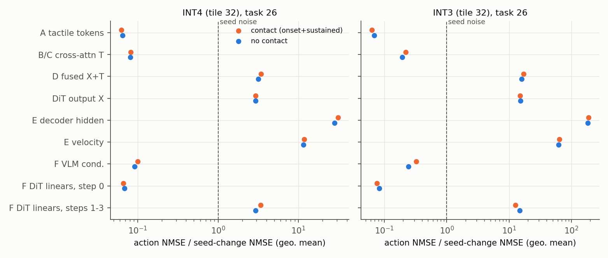
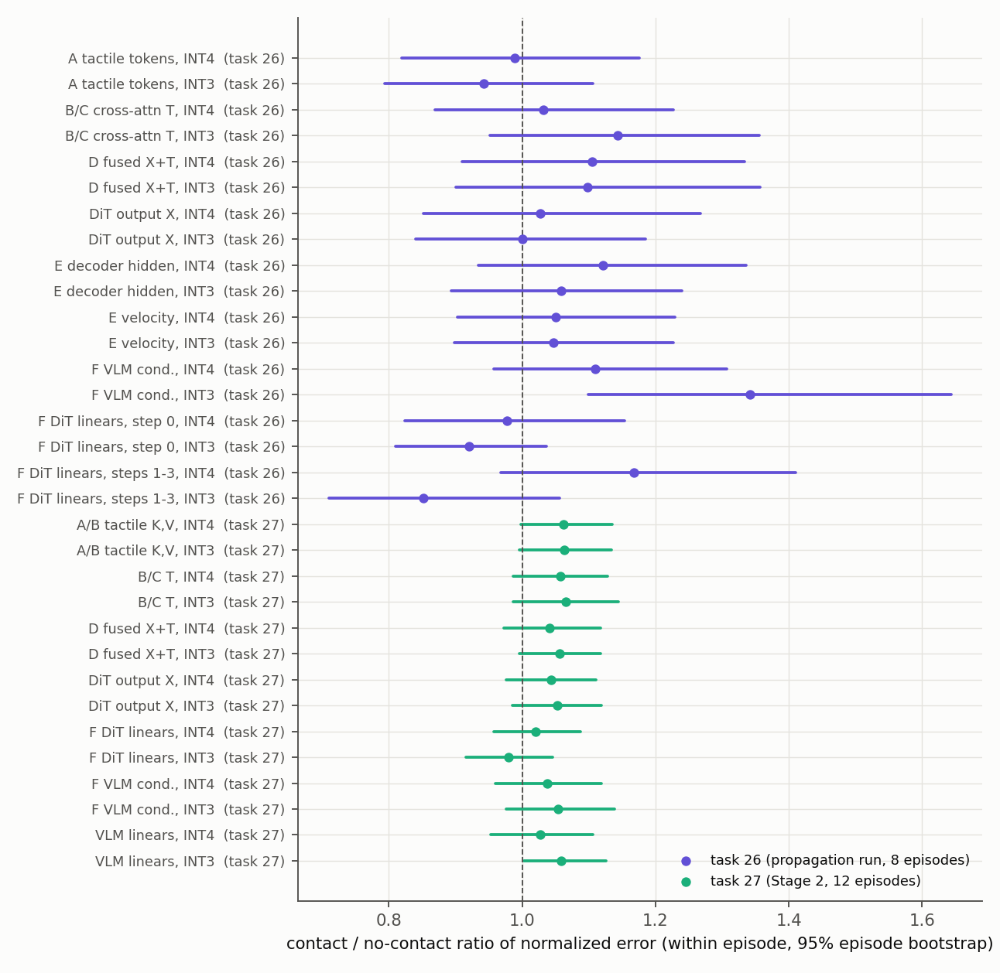

# CONTACT_SENSITIVITY — 접촉 상태에 따라 양자화 민감도가 커지는가 (Stage 1–2)

작성 2026-11-24. 모든 수치는 측정이다(오프라인, 시연 replay 관측, GR00T N1.5 tactile, BF16 기준).

## 1. 방법

- **관측**: replay-generalization 시연의 실제 관측을 사용했다(카메라 4대, 활성 관절, TacMap 깊이 지도).
  - 작업 27: Stage 2, 시연 12개, 24 프레임 간격, 관측 389개. 사전 등록(NOTES 21:32)은 시연 20개였는데, GPU 경쟁으로 12개에서 멈췄다(NOTES 22:57).
  - 작업 26: 추가 분석(전파), 시연 8개, 40 프레임 간격, 관측 141개.
  - 작업 27: 같은 전파 분석 반복(11/24 03:22–04:15), 시연 8개, 40 프레임 간격, 관측 164개.
- **접촉 상태**: 센서 수준 `contact_mask`로 정했다. none은 현재와 직전 16 프레임 모두 무접촉, onset은 시작, sustained는 지속, release는 해제다. "접촉"은 onset과 sustained를 합친 것이다.
- **양자화**: tile 32 단위 per-token-row fake quant(FP16 scale), INT8/4/3/2. 위치 하나만 양자화하고 나머지는 BF16으로 둔다.
- **지표**: 같은 flow seed의 BF16 출력 대비 action NMSE(시연 명령의 차원별 표준편차로 정규화).
  - 관측마다 "flow seed만 바꿨을 때의 NMSE"(noise floor)로 나눈다. 이 값이 1이면 양자화 오차가 정책 자체의 무작위성과 같은 크기다.
- **접촉 효과**: 같은 시연 안에서 접촉 관측과 비접촉 관측의 정규화 오차를 로그 평균 차로 비교한 비율이다(장면 변화 통제). 95% 구간은 시연 단위 bootstrap 2,000회다.
- **스크립트**: `scripts/ci23_sens.py`, `ci23_analyze_sens.py`, `ci23_prop.py`, `ci23_analyze_prop.py`.
- **결과 파일**: `stage2/task27/sens_summary.json`, `prop/task{26,27}/prop_summary.json`, `prop/two_tasks_ratios.json`.

## 2. Contact gate와 촉각 기여

이 정책에는 contact gate가 없다. 그래서 gate 값 대신 촉각 기여 ‖T‖/‖X‖를 쟀다. T는 촉각 cross-attention 출력, X는 DiT 출력의 action token이다.

| | 작업 27 | 작업 26 |
|---|---|---|
| 비접촉 / onset / sustained / release | 0.066 / 0.067 / 0.067 / 0.065 (Stage 2) | — |
| 접촉 / 비접촉, 시연 내 비율 | **1.02 [0.98, 1.05]**(Stage 2), 1.01 [0.97, 1.05](전파 분석) | **1.13 [1.06, 1.20]** |
| flow step 0→3, 접촉 | — | 0.097 → 0.085 → 0.081 → 0.073 |
| flow step 0→3, 비접촉 | — | 0.086 → 0.075 → 0.072 → 0.065 |

- 작업 27에서는 접촉해도 촉각 기여가 그대로다.
- 작업 26에서는 13% 커진다.
- 두 작업 모두 촉각은 X의 약 7–10% 크기의 작은 보정 항이다.

## 3. 위치별 양자화 오차와 접촉 효과(작업 27, Stage 2)

INT8–INT2 열은 비접촉 관측의 정규화 오차(× noise, 기하평균)다. 마지막 세 열은 접촉/비접촉 비와 95% 구간이다.

| 위치 | INT8 | INT4 | INT3 | INT2 | 접촉/비접촉 INT8 | INT4 | INT3 |
|---|---|---|---|---|---|---|---|
| 촉각 K,V (tac_kv) | 0.08 | 0.08 | 0.08 | 0.09 | 1.06 [0.99,1.14] | 1.06 [1.00,1.14] | 1.06 [1.00,1.13] |
| 촉각 출력 T (tac_delta) | 0.08 | 0.11 | 0.22 | 1.2 | 1.06 [0.99,1.14] | 1.06 [0.99,1.13] | 1.06 [0.99,1.15] |
| 합류 X+T (fused) | 0.09 | **4.0** | 20 | 423 | 1.05 [1.00,1.11] | 1.04 [0.97,1.12] | 1.06 [1.00,1.12] |
| DiT 출력 X (dit_out) | 0.09 | 3.5 | 18 | 316 | 1.05 [0.98,1.13] | 1.04 [0.98,1.11] | 1.05 [0.99,1.12] |
| DiT linear 입력 전체 | 0.09 | 2.5 | 12 | 205 | 1.04 [0.97,1.10] | 1.02 [0.96,1.09] | 0.98 [0.92,1.05] |
| VLM 조건(vl_cond) | 0.08 | 0.10 | 0.23 | 7.5 | 1.07 [1.00,1.14] | 1.04 [0.96,1.12] | 1.05 [0.98,1.14] |
| VLM linear 입력 전체 | 0.08 | 0.41 | 3.1 | 748 | 1.05 [0.98,1.13] | 1.03 [0.95,1.11] | 1.06 [1.00,1.13] |

INT2 접촉/비접촉 비는 다음과 같다. 이 정밀도에서는 오차가 noise의 수백 배로, 정책이 이미 망가져 있다.
- VLM linear: 1.34 [1.19, 1.48]
- T: 1.14 [1.03, 1.26]
- DiT linear: 1.08 [1.01, 1.17]

읽는 법:
- **민감도는 위치가 정한다.** INT4 오차는 action head 출력 경로(X+T, X, DiT linear)에서 noise의 2.5–4배다. 촉각 경로와 VLM 조건은 noise의 0.1배 수준이다.
- **접촉 효과는 INT4·INT3에서 1.02–1.06이고, INT8에서도 같은 크기(1.04–1.07)다.** INT8 오차는 noise의 0.08배로 사실상 측정 바닥이다. 그런데도 비율이 같다는 것은 이 5% 남짓한 차이가 정밀도 요구가 아니라는 뜻이다. 접촉 관측에서 seed noise 바닥이 조금 작아서 생기는 정규화 효과로 해석한다.
- **정규화 효과의 직접 확인(사후 점검, 11/24 00:36).** 분모와 분자를 나눠 봤다.
  - 분모: 접촉 관측의 seed noise 바닥이 비접촉보다 작다. 작업 27은 0.966 [0.909, 1.027], 작업 26은 0.941 [0.79, 1.11]이다.
  - 분자: 정규화하지 않은 원 오차의 접촉/비접촉 비를 보면 INT4에서 사실상 1이다.

    | 작업 27, INT4 | 원 오차 비 |
    |---|---|
    | X+T | 1.005 [0.987, 1.023] |
    | X | 1.008 [0.997, 1.019] |
    | DiT linear | 0.986 [0.966, 1.006] |
    | VLM linear | 0.992 [0.928, 1.066] |

    작업 26에서는 디코더 은닉 INT4만 원 오차가 1.056 [1.010, 1.110]으로 조금 크고, X+T는 1.04 [0.99, 1.09]다.
  - 결론: 정규화 비의 약 5%는 대부분 분모(noise 바닥)에서 온다. 양자화 오차 자체는 접촉으로 거의 변하지 않는다.
- 사전 등록 판정("95% 구간이 1을 넘으면 증가")을 기계적으로 적용하면 다섯 항목이 걸린다: tac_delta INT2, dit_linear INT2, vl_cond INT8, llm_linear INT3·INT2.
  - 이 가운데 실용 정밀도(INT4 이상)에서 INT8 바닥보다 큰 것은 없다.
  - INT3인 llm_linear(1.06)도 INT8 바닥(1.05)과 같다.

## 4. 촉각 기여 → 민감도(Spearman, 작업 27)

| 위치 | 전체 관측 ρ | 접촉 관측만 ρ |
|---|---|---|
| 촉각 K,V INT4 | −0.26 [−0.40, −0.11] | −0.14 [−0.32, +0.06] |
| T INT4 | −0.11 [−0.26, +0.07] | +0.01 [−0.18, +0.21] |
| T INT3 | +0.08 [−0.10, +0.24] | +0.19 [+0.00, +0.40] |
| X+T INT4 | −0.26 [−0.39, −0.13] | −0.12 [−0.28, +0.07] |

- 촉각 기여가 클수록 민감도가 커진다는 양의 관계는 보이지 않는다. 오히려 음이거나 0이다.
- 작업 27은 촉각 기여 자체가 접촉과 무관하다(§2). 사전 등록대로 "접촉 → 기여 → 민감도" 경로는 이 작업에서 성립하지 않는다.

## 5. 행동 차원별(팔/손)

손 관절만 따로 보면 접촉/비접촉 비는 오히려 1에 더 가깝다(작업 27, INT4).

| 위치 | 손 관절 비 |
|---|---|
| 촉각 K,V | 1.02 [0.96, 1.09] |
| X+T | 1.01 [0.95, 1.08] |
| DiT linear | 0.99 [0.93, 1.04] |
| VLM linear | 1.01 [0.94, 1.09] |

예외는 VLM linear INT3의 손 관절 1.10 [1.04, 1.17] 하나다.

## 6. 층(위치)별 정리: 작업 26, 촉각 → 하류

INT4 정규화 오차를 위치별로 보면(접촉/비접촉 비와 구간):

| 위치 | INT4 오차(× noise) | 접촉/비접촉 |
|---|---|---|
| 촉각 token | 0.06 | 0.99 [0.82, 1.18] |
| T | 0.08 | 1.03 [0.87, 1.23] |
| X+T | 3.2 | 1.11 [0.91, 1.33] |
| 디코더 은닉 | 28.9 | 1.12 [0.93, 1.34] |
| 속도 | 11.4 | 1.05 [0.90, 1.23] |
| VLM 조건 | 0.09 | 1.11 [0.96, 1.31] |
| DiT linear, flow step 0 | 0.07 | 0.98 |
| DiT linear, step 1–3 | 3.1 | 1.17 [0.97, 1.41] |

- 오차는 촉각이 합류한 뒤가 아니라 **action head 출력 경로 자체**(X, 디코더)에서 크다.
- **마지막 flow step**이 오차를 정한다. X+T INT4를 step별로 보면 0.07 / 0.08 / 0.08 / **3.0**이다.
- 모든 위치에서 접촉/비접촉 구간이 1을 포함한다.
- 작업 27에서 같은 분석을 반복했다(관측 164개, 11/24 03:22–04:15). INT4·INT3에서 모든 위치의 접촉/비접촉 비가 0.96–1.04이고, 구간이 1을 포함한다(`TACTILE_INJECTION_AND_PRECISION_PROPAGATION.md` §11).

## 7. 결론(Stage 2)

- 사용 가능한 정밀도(INT8·INT4·INT3)에서 **접촉은 어느 위치의 양자화 민감도도 의미 있게 키우지 않는다.** 남는 약 5% 차이는 INT8에서도 똑같이 보이는 정규화 효과다.
- 민감도는 위치(action head 출력, 마지막 flow step)가 정하고 접촉과는 무관하다.
- 촉각 기여는 작업 26에서만 접촉 시 13% 커진다. 그래도 민감도로 이어지지 않는다.
- 작업 27 전파 분석(관측 164개)에서도 같은 결론이 나왔다.
- 이 정책은 폐루프에서 촉각을 쓴다(촉각 제거 시 성공률 58% → 42%, p = 0.077, `CLOSED_LOOP_RESULTS.md`). 촉각이 중요하다는 것과 접촉 시 더 높은 정밀도가 필요하다는 것은 이 정책에서 서로 다른 현상으로 나타났다.
