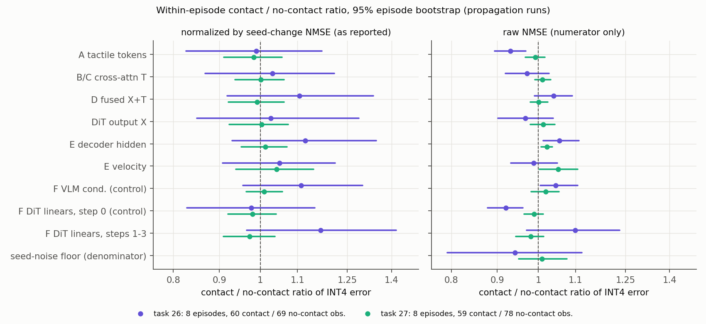

# FINAL_ASSESSMENT — 최종 판단

작성 2026-11-24.
- 근거 문서: `ENVIRONMENT_STATUS.md`, `POLICY_FEASIBILITY.md`, `CONTACT_SENSITIVITY.md`, `PRECISION_DEMAND.md`, `JOINT_WA_RESULTS.md`, `CLOSED_LOOP_RESULTS.md`, `HARDWARE_ANALYSIS.md`, `RELATED_WORK.md`, `TACTILE_INJECTION_AND_PRECISION_PROPAGATION.md`.
- 점수는 오프라인(Stage 0–3, 전파 분석)과 폐루프(50쌍) 결과를 모두 본 뒤에 매겼다.
- "측정"은 이 기계에서 실행한 결과다. "인용"은 앞선 캠페인이나 외부 자료, "추정"은 계산이다.

## 결론

> Primary research question: Does physical contact increase the minimum numerical precision required by tactile-aware VLA models, and can this changing precision demand be exploited through dynamic joint weight–activation quantization to reduce inference cost without compromising closed-loop manipulation success?

**이 정책에서는 아니다. 가설을 기각한다.**

1. **촉각은 쓰인다(중간 근거).** 폐루프에서 촉각을 지우면 작업 성공률이 58%에서 42%로 떨어졌다. 사전 등록한 McNemar는 p = 0.077이다. 명세가 구분하라고 한 두 현상 가운데 "촉각 정보의 중요성"은 이 정도로 확인됐다.
2. **그러나 접촉은 필요한 수치 정밀도를 바꾸지 않는다(측정).**
   - 접촉/비접촉 오차 비는 INT4·INT3에서 1.02–1.06으로, INT8 바닥(1.04–1.07)과 같다(작업 27 Stage 2). 같은 작업의 전파 분석에서는 0.96–1.04다.
   - 정규화하지 않은 원 오차 비는 X+T INT4에서 1.005 [0.987, 1.023]다.
   - r\* 중앙값도, 중요 channel의 위치도 접촉과 비접촉이 같다.
3. **정밀도 요구는 위치가 정한다.** 민감한 곳은 action head 출력 경로(X, X+T, 디코더)와 마지막 flow step이다. 이 위치는 정적이고 작다. 호출당 데이터 128 KB, 연산은 전체의 1% 미만이다.
4. 따라서 접촉 인지 동적 정밀도, 접촉 조건 joint W/A, 전용 HW, PIM 모두 근거가 없다. 사전 등록 gate에 따라 Stage 4–6의 큰 실험은 하지 않았다.
5. **한계.**
   - 촉각이 VLM 밖(DiT 출력 뒤)에 들어가는 정책 하나만 시험했다. VLM 내부 주입(DeCAL형)은 가중치가 없어 시험하지 못했다.
   - 촉각 branch 자체의 INT4 충분성은 오프라인 지표의 해상도 밖이다.
   - 폐루프는 비공식 Isaac Sim 6.2 이식에서 돌렸고, 촉각 의존도의 근거는 p = 0.077이다.

## 단계별 진행과 판정

| 단계 | 판정 기준(사전 등록) | 결과 | 다음 단계 |
|---|---|---|---|
| Stage 0 정책 확보·촉각 ablation | 촉각 정책 실행 가능, 촉각 영향 확인 | Bench2Dex GR00T N1.5 tactile 채택. 오프라인 영향은 작음(seed noise의 0.05배), 폐루프 −16%p(p = 0.077) | 진행 |
| Stage 1 접촉 상태·폐루프 기준선 | 정상 촉각 관측, 폐루프 실행 | 6.2 이식, TacMap 검증 통과(IoU 0.66–0.72), 렌더링 수정, native 29/50 | 진행 |
| Stage 2 위치별 민감도 | 접촉/비접촉 비 구간이 1을 넘음 | 실용 정밀도에서 INT8 바닥을 넘는 항목 없음 | 부정 |
| Stage 3 r\*(s, ε) | 접촉 r\* 중앙값이 크고 구간이 겹치지 않음 | 모든 설정에서 "아님" | 부정 |
| 전파 분석(가설 A/B/C) | 촉각 국소, 융합 유도, 하류 전파 | 두 작업 모두 셋 다 기각(작업 26 관측 141개, 작업 27 관측 164개) | 부정 |
| Stage 4 폐루프 동적 정밀도 | Stage 2–3 긍정일 때만 | gate 닫힘, 실행 안 함 | 중단 |
| Stage 5 joint W/A | 같음 | DiT 부분 측정만(49 관측) | 중단 |
| Stage 6 GPU/PIM | 1–4 유망할 때만 | 지연 분해만 측정 | 중단 |

## Q1–Q9

**Q1. 촉각을 실제로 쓰는 VLA에서 접촉 상태에 따라 numerical sensitivity가 증가하는가?**

**아니다.**
- 전제(촉각을 쓰는가): 폐루프 성공률 58% 대 42%, p = 0.077(측정). 오프라인 호출당 영향은 seed noise의 0.05배다. 그래서 "쓰지만 근거 강도는 중간"이다.
- 민감도(측정):
  - 작업 27, 관측 389개: INT4·INT3 접촉/비접촉 비가 1.02–1.06이다. INT8에서도 1.04–1.07로 같은데, 이것은 정규화 효과다. 분모인 seed noise 바닥이 접촉 시 0.966배로 작다.
  - 원 오차 비(X+T INT4)는 1.005 [0.987, 1.023]다.
  - 전파 분석은 두 작업에서 했다. INT4에서 모든 위치의 구간이 1을 포함한다.
    - 작업 26(관측 141개)
    - 작업 27(관측 164개): INT3에서도 모두 1을 포함하며, 비는 0.96–1.04다.

**Q2. 접촉 상태에 따라 최소한의 action accuracy를 유지하는 데 필요한 고정밀 activation/channel 수가 달라지는가?**

**아니다(측정).**
- DiT 전체의 r\*(ε = 0.25, 작업 27, 관측 300개):

  | 선택 | 접촉 | 비접촉 |
  |---|---|---|
  | 동적 | 35% | 35% |
  | 정적 | 50% | 50% |
  | 무작위 | 75% | 75% |

  사전 등록 판정은 모든 설정(선택 3종 × ε 3종)에서 "아님"이다.
- X+T의 r\*는 두 작업 모두 75% 대 75%다.
- 중요 channel 상위 32개의 겹침은 접촉–비접촉이 접촉끼리, 비접촉끼리와 같다.

  | 작업 | 접촉–비접촉 | 접촉–접촉 | 비접촉–비접촉 |
  |---|---|---|---|
  | 26 | 0.75 | 0.77 | 0.78 |
  | 27 | 0.73 | 0.73 | 0.74 |
- 필요한 수를 정하는 것은 접촉이 아니라 channel 선택 방법이다(동적 35%, 정적 50%, 무작위 75%).

**Q3. 이 현상은 task/phase 차이나 관측 변화만으로 설명되지 않는가?**

**설명해야 할 접촉 고유 효과가 남지 않았다(측정).**
- INT2·INT3에서 보인 접촉 효과는 촉각이 닿지 않는 대조 위치에서 더 컸다. VLM 조건 INT3이 1.34, flow step 0의 DiT INT2가 1.37이다. 그러므로 이 효과는 접촉 phase의 장면·자세 변화(관측 변화)로 설명된다.
- 실용 정밀도에서 남는 약 5%의 정규화 비는 분모(noise 바닥)에서 온다.
- 접촉 시 촉각 기여가 커지는 작업 26(1.13배)과 그렇지 않은 작업 27(1.02배)에서 결론이 같다.

**Q4. Contact-aware dynamic precision이 static/task-aware/phase-aware mixed precision보다 실제 폐루프에서 유리한가?**

**폐루프에서는 시험하지 않았다.** 사전 등록 gate가 닫혔기 때문이다(Stage 2–3에서 접촉 의존 요구가 확인될 때만 실행).
- 오프라인 근거로는 유리할 이유가 없다. 접촉이 r\*도 중요 channel 위치도 바꾸지 않으므로, 접촉 인지 선택은 정적 선택과 같은 channel을 고르게 된다.
- 앞선 LIBERO 캠페인(다른 정책, 인용) 결과도 같은 방향이다.
  - task별 선택은 전역 정적 선택과 구분되지 않았다(1.22배 [0.89, 1.66]).
  - phase·접촉 조건 혼합은 같은 bit의 균일보다 나빴다.
- 이번 폐루프는 정밀도가 아니라 촉각 의존도(native 대 zero)만 쟀다.

**Q5. Joint W/A quantization으로 같은 정확도를 더 적은 연산·메모리 비용으로 달성할 수 있는가?**

**접촉 조건 joint W/A로는 근거가 없다.** 일반 W/A 양자화로는 가능하지만, 그것은 기존 기법이다.
- 이 정책의 DiT(측정, 관측 49개): W4+A4 오차는 noise의 2.64배, A4 단독은 2.11배다. W4가 오차를 25% 더한다.
- 동적 W[:,S] 쌍 보호는 두 형식을 저장해야 해서 정적 대비 2.2배다(추정).
- 앞선 캠페인(인용): W8A8이 실측 1.25배 빨랐고, 폐루프 손실은 검출되지 않았다.

**Q6. 기존 GPU 최적화보다 새로운 하드웨어 데이터플로가 필요한가?**

**아니다.**
- 민감 위치는 정적이고 작다. 호출당 128 KB이고 디코더 시간은 0.19 ms(0.2%)다(측정). 정적 위치별 혼합 정밀도는 kernel 선택으로 충분하다(추정).
- 촉각 경로는 지연의 0.8%다(측정).
- 호출당 지연 105 ms 가운데 VLM이 58%, DiT가 24%다(측정). batch 1에서 대역폭 하한(약 8 ms)이 실측보다 훨씬 작다(추정). 병목은 kernel 실행과 호스트 작업이라 GPU 소프트웨어 최적화의 대상이다.

**Q7. PIM을 적용할 명확한 이유가 있는가?**

**아니다.**
- 명세대로, 민감도 변화만으로 PIM을 주장하지 않는다. 이번에는 그 변화조차 없다.
- DiT의 낮은 산술 강도(약 25 FLOP/B, 추정)는 촉각과 무관한 일반적 관찰이다. 실측 DiT 시간은 대역폭 하한의 5배다.
- 앞선 PIM 가설(11/17)도 측정에서 모두 기각됐다(인용).

**Q8. 현재 연구가 DeCAL, DyQ-VLA, QbD-VLA, mixed-precision accelerator 연구와 충분히 다른가?**

**아니다.**
- 남은 차별점은 "접촉 신호를 정밀도 전환에 쓴다" 하나다. 측정에서 그 신호는 정밀도 요구와 무관했다.
- 나머지 요소는 선행 연구가 다룬다(`RELATED_WORK.md`).

  | 요소 | 선행 연구 |
  |---|---|
  | 상태 기반 동적 정밀도 | DyQ-VLA |
  | 폐루프 기반 bit 할당 | QbD-VLA |
  | channel 단위 혼합 정밀도 | QVLA |
  | 소수 고정밀 channel + 대응 가중치 HW | OLAccel, OliVe, MicroScopiQ, Atom |
  | timestep별 정밀도 | Q-Diffusion, TDQ 등 |

- DeCAL은 촉각 주입 구조 연구다. 그 구조(VLM 내부 주입)에서 정밀도 요구가 전파되는가는 가중치가 없어 시험하지 못한 유일한 열린 질문이다.

**Q9. 실제 결과를 기준으로 이 연구를 계속 진행할 가치가 있는가?**

**접촉 인지 정밀도 HW 방향은 중단을 권한다.**
- 핵심 전제(접촉 → 정밀도 요구 증가)가 두 작업과 세 종류 지표(민감도, r\*, 중요 channel)에서 모두 성립하지 않았다.
- 앞선 LIBERO 캠페인 두 번(촉각 없음)과도 결론이 같다. 정밀도 요구는 위치에 따라 정적으로 정해지고, 입력이나 상태에 따라 동적으로 바뀌지 않는다.
- 다시 시험할 조건은 하나뿐이다. VLM 내부에 촉각을 넣는 정책의 공개 가중치가 나오면, 이번 오프라인 Stage 2 프로토콜로 재시험한다(스크립트 재사용, 약 반나절, 추정). 새 3B급 모델 학습은 명세상 하지 않는다.
- 접촉과 무관한 부산물로 "마지막 flow step만 민감"(step별 INT4 오차 0.07 / 0.08 / 0.08 / 3.0)이 있다. step별 정밀도로 쓸 수 있지만, diffusion timestep 양자화 계열과 겹친다.

## 최종 질문: 정밀도 요구는 촉각 feature에 국한되는가, 전파되는가?

**어느 쪽도 아니다. 접촉이나 촉각 융합 때문에 늘어나는 정밀도 요구 자체가 관측되지 않았다.**

| 경우 | 결과 |
|---|---|
| 촉각 정보는 중요하지만 INT4로 충분 | **가장 가깝다.** 촉각 제거 시 폐루프 −16%p(p = 0.077). 촉각 token과 T의 INT4 오차는 INT8과 같은 바닥이고 r\* = 0%다. 단, 촉각 제거의 오프라인 영향도 이 바닥 아래라 INT4의 폐루프 충분성은 직접 확인하지 못했다 |
| 촉각 branch만 높은 정밀도 필요 | 아니다 |
| 융합 activation의 고정밀 channel 수 증가 | 아니다. X+T는 원래 민감하지만(r\* 75%) 접촉과 무관하다 |
| Action Expert까지 전파 | 아니다. 디코더, 속도, 다음 flow step DiT 모두 접촉/비접촉 구간이 1을 포함한다 |

## 전파 분석 작업 27

사전 등록(NOTES 22:56) 대상이었는데 GPU를 폐루프에 먼저 배정했다. 그래서 폐루프가 끝난 뒤 03:22–04:15에 같은 조건으로 실행했다. 관측은 164개다(접촉 59, 비접촉 78). 자세한 내용은 `TACTILE_INJECTION_AND_PRECISION_PROPAGATION.md` §11에 있다.
- 촉각 기여 ‖T‖/‖X‖는 접촉/비접촉 1.01 [0.97, 1.05]이다. 접촉해도 커지지 않는다.
- INT4·INT3에서 모든 위치의 접촉/비접촉 비가 0.96–1.04이고, 구간이 1을 포함한다. 위치별 오차의 크기 순서와 "마지막 flow step만 민감"(X+T INT4 0.09 / 0.10 / 0.10 / 3.85)도 재현됐다.
- r\*(ε = 0.25)는 접촉과 비접촉이 같다: T 0%, X+T 75%, 디코더 75%.
  - 디코더 INT8 보호의 평균 차이 +0.04 [+0.015, +0.070]은 작업 26(−0.12)과 방향이 반대다. BF16 보호에서는 나타나지 않는다.
- 사후 원 오차 분해에서 디코더는 두 작업 모두 접촉 시 2–6% 크다. 그러나 촉각이 닿지 않는 대조 위치도 같은 크기로 1을 벗어나서(작업 26: 0.92–1.05), 관측 변화 수준으로 본다.
- 가설 A/B/C는 작업 27에서도 모두 기각한다.

## 점수(각 항목 100점 기준)

점수는 "접촉에 따라 정밀도를 동적으로 바꾸는 HW/SW co-design"이라는 **제안 방향의 가치**다. 이번 실험의 품질 점수가 아니다. 실험 품질은 '실험적 근거'와 '재현성' 항목의 근거 칸에 따로 적었다.

| 항목 | 점수 | 근거 |
|---|---:|---|
| Novelty | 15 | 접촉을 정밀도 trigger로 쓰는 직접 선행은 검색 범위 안에 없다. 그러나 나머지 요소는 모두 선행이 있고(Q8), 그 trigger가 측정에서 정밀도 요구와 무관했다 |
| Algorithmic contribution | 10 | 접촉 인지 선택은 정적 선택과 같은 channel을 고른다(겹침 0.75–0.78, r\* 동일). 남는 관찰(동적 \|x\|·\|W\| 선택 35% 대 정적 50%, 마지막 flow step만 민감)은 기존 outlier 처리, timestep 양자화와 같은 계열이다 |
| HW/SW co-design potential | 8 | 활용할 동적 신호가 없다. 민감 위치는 정적이고 호출당 128 KB, 연산 1% 미만이라 kernel 선택으로 충분하다. 촉각 branch는 지연의 0.8%다 |
| 실험적 근거 | 15 | 제안을 지지하는 근거는 없다. 반대(기각) 근거의 품질은 높다: 사전 등록, 두 작업(전파 분석 관측 141 + 164개, Stage 2 389개, Stage 3 300개), 시연 내 비교, 정규화 분해, 촉각이 닿지 않는 대조 위치, 촉각 센서 이식 검증 뒤 폐루프 50쌍. 한계: 정책 구조 하나, Stage 2 축소(시연 20 → 12), 촉각 branch는 지표 해상도 밖 |
| 성능 및 정확도 향상 가능성 | 10 | 접촉 인지로 얻는 절감은 정적 대비 0이다(같은 channel). 얻을 수 있는 절감(W8A8 약 1.25배, 정적 위치별 혼합)은 접촉과 무관한 기존 기법이다 |
| 재현성 | 65 | 공개 checkpoint와 자산을 썼다. 스크립트, 사전 등록 시각, 원자료(JSONL), 이식 변경 14항목을 보존했다. 감점: 공식 경로(Isaac Sim 5.1)가 이 드라이버에서 실행되지 않아 비공식 6.2 이식에 의존한다. apptainer와 NGX bind가 필요하다. 시뮬레이터 비결정성으로 짝 궤적이 첫 접촉 전에 갈라진다. 리더보드 수치와 직접 비교할 수 없다 |
| ISCA/HPCA 경쟁력 | 5 | 새 하드웨어 문제가 확인되지 않았다. 부정 결과는 분석·workshop 수준이다 |

단순 평균은 18점이다. 앞선 LIBERO 접촉 조건 캠페인의 19점(가중 합)과 같은 수준이다.

## 하지 않은 것

| 항목 | 이유 |
|---|---|
| Stage 4 폐루프 정밀도 arm(접촉 인지, 정적, 작업별, phase별) | 사전 등록 gate 닫힘 |
| Stage 5 joint W/A 전체 sweep, 접촉 조건 W/A | 같음. DiT W4A4 부분 측정만 |
| Stage 6 저비트 kernel 실측, PIM 시뮬레이션 | 같음. 지연 분해만 측정 |
| Stage 2 시연 20개 | GPU 경쟁으로 12개에서 멈춤(NOTES 22:57) |
| Stage 3 VLM 범위, gradient/oracle 선택 | 우선순위 조정(NOTES 23:17) |
| 촉각 branch INT4 폐루프 arm, native 반복 실행, 작업 26 폐루프 | 사전 등록하지 않음. 가설 기각 뒤 큰 실험 중단 |
| VLM 내부 주입 정책(DeCAL) | 공개 가중치 없음. 대규모 학습 금지 |
| Isaac Sim 5.1 공식 경로 | 드라이버 620.70에서 `librtx.scenedb` segfault, 드라이버 교체 권한 없음 |
