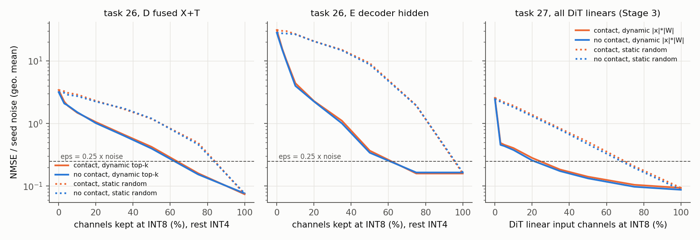
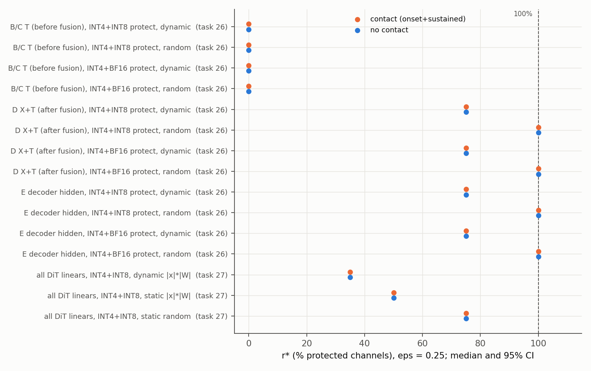

# PRECISION_DEMAND — 접촉 상태별 최소 고정밀 비율 r* (Stage 3)

작성 2026-11-24. 모든 수치는 측정이다(오프라인, 작업 27; 전파 분석은 작업 26).

## 1. 정의와 설정(사전 등록 NOTES 21:32, 22:56)

- **r\*(ε)**: 고정밀로 남길 입력 channel 비율의 최솟값.
  - 시험한 비율은 0, 3, 5, 10, 20, 35, 50, 75, 100%다.
  - 기준: action NMSE ≤ ε × (그 관측 자신의 seed 변경 NMSE). ε은 0.1, 0.25, 0.5를 모두 보고한다.
  - 100%에서도 못 미치면 ">100%"로 따로 센다. INT8로도 부족하다는 뜻이다.
- **범위(작업 27)**:
  - 대상: action head DiT의 linear 112개 입력 전체.
  - 정밀도: 저정밀 INT4, 고정밀 INT8(activation tile 32).
  - 가중치: BF16('A' 설정).
  - 관측: 시험 시연 0–11, 32 프레임 간격, 300개.
  - 정적 선택 보정: 시연 12–49의 16 관측.
- **선택 방법**:
  - `rand_s`: 정적 무작위.
  - `axw_s`: 정적 |x|·‖W 열‖(보정 평균).
  - `axw_d`: 동적. 같은 점수를 호출마다 그 호출의 activation으로 다시 계산한다.
- **판정**: 접촉 상태의 r\* 중앙값이 비접촉보다 크고, 두 중앙값의 시연 단위 bootstrap 구간이 겹치지 않을 때만 "접촉 시 필요한 고정밀 channel 수 증가"로 기록한다.
- **실행하지 못한 항목(사전 등록 우선순위 조정, NOTES 23:17)**:
  - 가중치 쌍 WA: 49 관측만 측정, 부분 결과는 `JOINT_WA_RESULTS.md`.
  - VLM 범위(llm).
  - gradient 선택과 oracle 선택. 위 판정이 모든 설정에서 부정이라 진행하지 않았다.
- **스크립트와 파일**: `scripts/ci23_rstar.py`, `ci23_analyze_rstar.py` → `stage3/task27/rstar_summary.json`.

## 2. 결과: DiT 전체, 작업 27

r\* 중앙값과 시연 bootstrap 95% 구간이다. ">100%"는 그 비율이 100%를 넘는 관측의 비율이다.

| 선택 | ε | 비접촉(155) | 접촉(103) | release(42) | 짝 차이(접촉−비접촉, 평균 r\*) | 판정 |
|---|---|---|---|---|---|---|
| 동적 \|x\|·\|W\| | 0.1 | >100% (52%) | 100% [100,>100] (50%) | 75% | +0.03 [−0.10, +0.16] | 아님 |
| 동적 \|x\|·\|W\| | 0.25 | **35%** [35, 35] | **35%** [35, 35] | 35% | +0.036 [+0.004, +0.066] | 아님 |
| 동적 \|x\|·\|W\| | 0.5 | 3% [3, 5] | 5% [3, 10] | 3% | +0.023 [0.000, +0.043] | 아님 |
| 정적 \|x\|·\|W\| | 0.25 | **50%** [50, 50] | **50%** [50, 50] | 50% | +0.041 [+0.007, +0.076] | 아님 |
| 정적 \|x\|·\|W\| | 0.5 | 20% | 20% | 20% | +0.031 [+0.013, +0.046] | 아님 |
| 정적 무작위 | 0.25 | **75%** [75, 75] | **75%** [75, 75] | 75% | +0.022 [−0.009, +0.053] | 아님 |
| 정적 무작위 | 0.5 | 75% | 75% | 50% | +0.030 [−0.005, +0.064] | 아님 |

같은 비율에서 오차를 직접 비교해도(접촉/비접촉, 시연 내) 결과는 같다.
- 모든 r에서 1.04–1.11이다.
- r = 100%(전부 INT8)에서도 1.09 [0.99, 1.21]이다.
- INT8 바닥에서 이미 같은 비율이 나오므로, 접촉 관측이 고정밀 channel을 더 필요로 한다는 증거가 아니다. `CONTACT_SENSITIVITY.md` §3과 같은 정규화 효과다.

## 3. 읽는 법

1. **중앙값 r\*는 모든 선택 방법과 ε에서 접촉과 비접촉이 같다.** 사전 등록 판정은 모든 설정에서 "아님"이다.
2. 평균 r\*의 짝 차이는 +2–4%p이고, 일부는 구간이 0을 넘는다. 이것은 앞에서 말한 정규화 효과(INT8에서도 +9%)의 크기와 맞다. 크기로 봐도 35% 중 3%p 정도라, 접촉에 따라 정밀도를 바꾸는 하드웨어가 아낄 수 있는 양은 작다(§5 추정).
3. **channel 선택 방법이 접촉보다 훨씬 크다.** ε = 0.25에서 필요한 고정밀 비율은 다음과 같다.

   | 선택 | 필요 비율 |
   |---|---|
   | 동적 \|x\|·\|W\| | 35% |
   | 정적 \|x\|·\|W\| | 50% |
   | 무작위 | 75% |

   중요도 기반 선택은 의미가 있다. 다만 그 중요도는 접촉 상태와 무관하다(§4).
4. 엄격한 ε = 0.1에서는 절반가량의 관측이 100% INT8로도 못 미친다. INT8 tile 양자화 자체의 오차(noise의 약 0.09배)가 이 기준에 가깝기 때문이다.

## 4. Channel importance 변화(작업 26, 전파 분석)

중요 channel 상위 32개(|activation| 기준)의 겹침 비율이다.

| 위치 | 접촉–접촉 | 비접촉–비접촉 | 접촉–비접촉 |
|---|---|---|---|
| X+T | 0.77 | 0.78 | 0.75 |
| T | 0.95 | 0.94 | 0.95 |

- 접촉 관측끼리 겹치는 정도와 접촉–비접촉이 겹치는 정도가 거의 같다. 접촉은 중요 channel의 위치를 바꾸지 않는다.
- 상위 channel 집중도(에너지 비율)도 X+T 0.484 대 0.484, T 0.474 대 0.474로 같다.

r\*(ε = 0.25, 작업 26) 중앙값은 다음과 같다.

| 위치 | 접촉 | 비접촉 | 짝 차이 |
|---|---|---|---|
| T | 0% | 0% | — |
| X+T, INT8 보호, 동적 | 75% | 75% | −0.003 [−0.07, +0.07] |
| X+T, INT8 보호, 무작위 | 100% | 100% | — |
| 디코더 은닉, INT8 보호, 동적 | 75% | 75% | −0.12 [−0.22, −0.01] |
| 디코더 은닉, BF16 보호, 동적 | 75% | 75% | +0.02 [−0.00, +0.05] |

- T는 INT4로 충분하다(오프라인 지표 기준. 이 지표의 해상도 한계는 `CLOSED_LOOP_RESULTS.md` §5).
- 디코더 은닉의 INT8 보호에서는 접촉 쪽이 오히려 덜 필요했다.

작업 27에서 같은 분석을 반복한 결과(관측 164개, `TACTILE_INJECTION_AND_PRECISION_PROPAGATION.md` §11)도 같다.
- r\*(ε = 0.25) 중앙값은 다음과 같다.

  | 위치 | 접촉 | 비접촉 |
  |---|---|---|
  | T | 0% | 0% |
  | X+T, 동적 | 75% | 75% |
  | 디코더 은닉 | 75% | 75% |

- 디코더 INT8 보호의 평균 r\* 차이는 +0.039 [+0.015, +0.070]이다. 작업 26(−0.12)과 방향이 반대이고, BF16 보호에서는 −0.009 [−0.024, +0.006]이다.
- 상위 32 channel 겹침(접촉–접촉 / 비접촉–비접촉 / 접촉–비접촉): X+T 0.73 / 0.74 / 0.73, T 0.91 / 0.91 / 0.91.

## 5. Task / phase / contact 통제

- **장면 통제**: 모든 접촉 효과는 같은 시연 안에서 짝지어 비교했다. 시연(장면, 물체 배치)이 바뀌어서 생기는 차이를 뺀 값이다.
- **phase 통제**: 촉각이 영향을 줄 수 없는 위치를 대조군으로 썼다.
  - flow step 0의 DiT linear는 촉각이 들어가기 전이다(작업 26). INT4에서 0.98 [0.82, 1.15], INT2에서 1.37 [1.13, 1.72]다.
  - VLM 조건은 촉각을 보지 않는다. INT3에서 1.34 [1.10, 1.64]다.
  - 이 대조군의 INT2·INT3 접촉 효과가 촉각 위치보다 크다. 즉 극저정밀에서 보이는 접촉 관측의 큰 오차는 **촉각 때문이 아니라 접촉 phase의 장면/자세 차이(관측 변화)** 때문이다.
- **task 통제**: 접촉 시 촉각 기여가 커지는 작업 26(1.13배)과 그렇지 않은 작업 27(1.02배) 모두에서 r\*는 접촉과 무관했다.

## 6. 결론(Stage 3)

- 접촉 상태에 따라 필요한 고정밀 activation channel 수는 달라지지 않는다. 사전 등록 판정은 모든 설정에서 "아님"이다.
- 필요 비율을 정하는 것은 위치(action head 출력 경로)와 channel 선택 방법(동적 35% 대 무작위 75%)이다.
- 사전 등록(명세 7.2)에 따라 Stage 4 이후의 접촉 조건 동적 정밀도 폐루프 arm은 진행하지 않는다.
