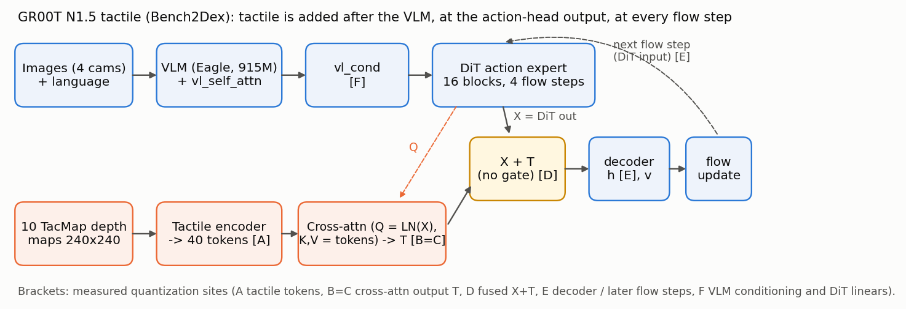
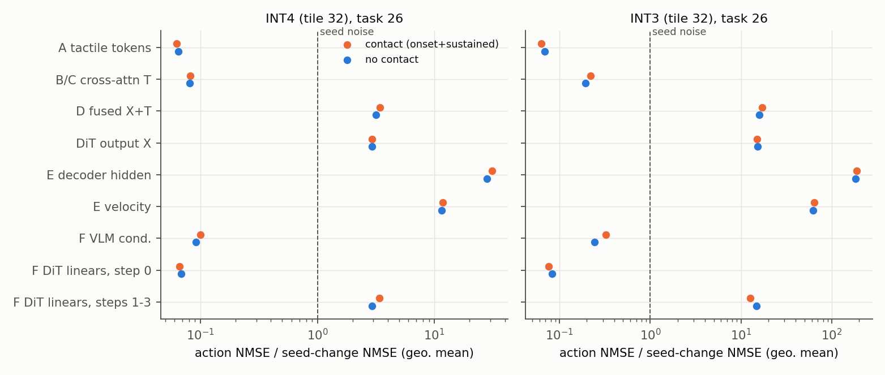
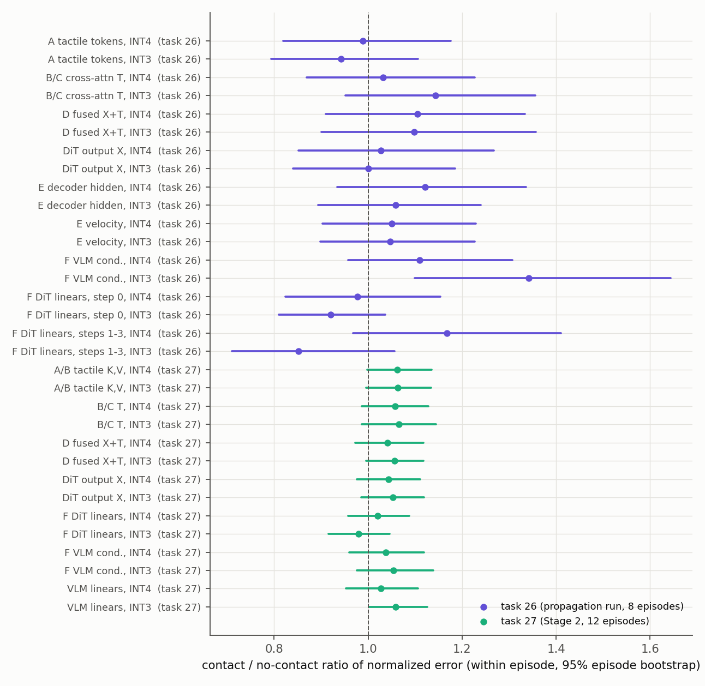
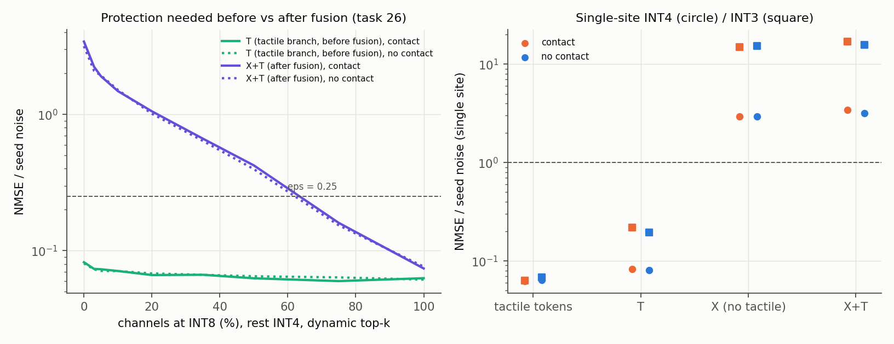
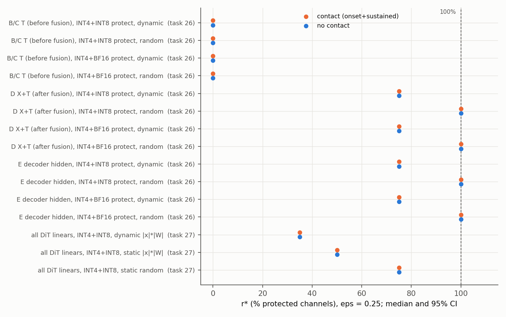
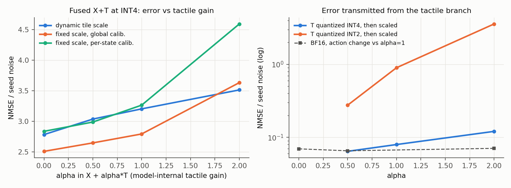
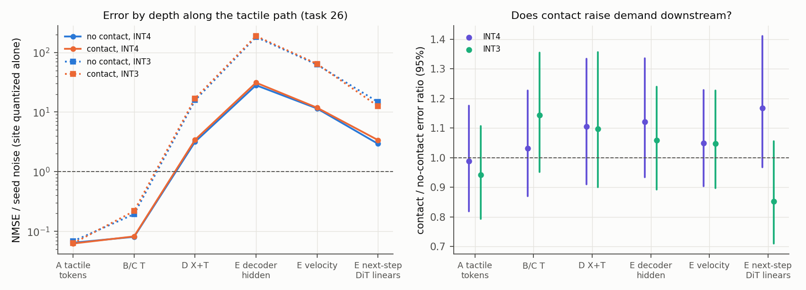
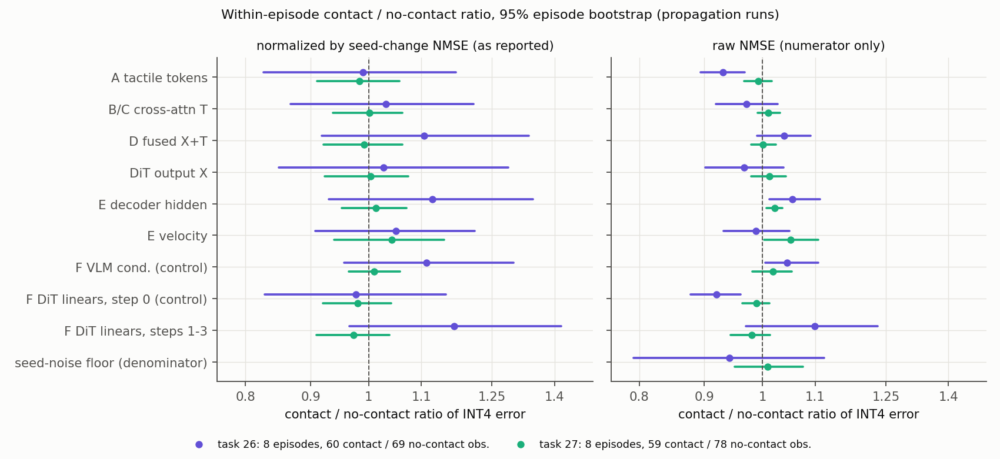

# TACTILE_INJECTION_AND_PRECISION_PROPAGATION — 촉각 주입 위치와 정밀도 요구의 전파

작성 2026-11-24. 대상은 Bench2Dex GR00T N1.5 tactile이다.
- 작업 26(iiwa7 + Sharpa): 전파 분석. 시연 0–7, 40 프레임 간격, 관측 141개(접촉 60, 비접촉 69, release 12). §1–§9의 그림과 표는 이 작업이다.
- 작업 27(UR5 + Wuji): Stage 2–3. 같은 전파 분석도 반복했다(관측 164개: 접촉 59, 비접촉 78, release 27). 결과는 §11에 있다.

모든 수치는 오프라인 측정이다.
- 사전 등록: NOTES 22:56.
- 스크립트: `scripts/ci23_prop.py`, `ci23_analyze_prop.py`, `ci23_figures.py`, `ci23_prop_two_tasks_figure.py`.
- 결과: `prop/task{26,27}/prop_summary.json`. 두 작업 비교는 `prop/two_tasks_ratios.json`이다.

## 최종 질문에 대한 답

> Is the increased numerical precision requirement confined to tactile-specific features, or does tactile fusion induce additional high-precision demand in the VLM's intermediate representations and downstream Action Expert?

**어느 쪽도 아니다. 접촉이나 촉각 융합 때문에 늘어나는 정밀도 요구 자체가 관측되지 않았다.** 명세가 구분하라고 한 네 경우로 정리하면 다음과 같다.

| 경우 | 결과 |
|---|---|
| 촉각 정보가 중요하지만 INT4로 충분 | **가장 가깝다. 단서가 둘 있다.** 중요도: 폐루프에서 촉각을 지우면 성공률이 58%에서 42%로 떨어졌다(p = 0.077, `CLOSED_LOOP_RESULTS.md`). 오프라인 호출당 영향은 seed 무작위성의 4–9%로 작다. INT4: 촉각 token과 T는 INT4·INT3 오차가 INT8과 같은 바닥(noise의 0.06–0.2배)이고, r\* = 0%다. 그러나 촉각을 통째로 지운 오프라인 영향(0.05배)도 이 바닥 아래다. 그래서 INT4가 폐루프에서 쓰이는 촉각 정보를 보존하는지는 오프라인 지표로 판별되지 않는다. 폐루프 INT4 arm은 돌리지 않았다 |
| 촉각 branch만 높은 정밀도 필요 | 아니다. 촉각 branch는 INT4로 충분하고, 접촉/비접촉 비도 INT4·INT3에서 1과 구분되지 않는다 |
| 융합 activation의 고정밀 channel 수 증가 | 아니다. X+T는 원래부터 민감하다(INT4에서 noise의 3.2–4.0배, r\* 75%). 하지만 접촉과 비접촉이 같다(작업 26: 1.11 [0.91, 1.33], 작업 27: 0.99 [0.92, 1.06]; r\*는 두 작업 모두 75% 대 75%). 중요 channel 위치도 접촉에 따라 바뀌지 않는다 |
| Action Expert까지 전파 | 아니다. 디코더 은닉, 속도, 다음 flow step의 DiT 모두 두 작업에서 접촉/비접촉 구간이 1을 포함한다(작업 27: 1.01, 1.04, 0.97) |

**높은 정밀도가 필요한 곳은 촉각과 무관하게 action head 출력 경로와 마지막 flow step이다.** 접촉 상태에 따라 정밀도를 바꾸는 하드웨어가 기댈 신호가 이 정책에는 없다.
- 사전 등록한 가설 A(촉각 국소), B(융합 유도), C(하류 전파)는 두 작업 모두에서 **기각**한다.
- 이 결론은 이 정책 구조(VLM 밖, gate 없는 post-DiT residual)에 대한 것이다. VLM 내부 주입(DeCAL형)은 가중치가 없어 시험하지 못했다(§9).

## 1. 실제 촉각 주입 위치(코드와 trace로 확인)

| 단계 | 모듈 | 모양, dtype |
|---|---|---|
| 입력 | TacMap 깊이 지도 10개(손끝 J4 사이트) | [1, 10, 1, 240, 240] bf16, 미터 |
| A | `tactile_encoder`(0.31M) | → [1, 40, 1536] bf16 |
| B = C | `tactile_cross_attn`(MHA 8 head, 5.25M). Q = `tactile_query_norm`(X), K/V = `tactile_key_norm`(token) | Q [1, 16, 1024] fp32, K/V [1, 40, 1536] fp32 → T [1, 16, 1024] bf16 |
| D | X + T. **gate 없음**(`post_dit`) | [1, 16, 1024] |
| E | `action_decoder` 1024→1024→64, flow 갱신, 다음 step DiT 입력 | [1, 16, 1024] → [1, 16, 64] |
| F | VLM 조건(`vlln`, `vl_self_attention` 출력)과 DiT 내부 linear | [1, 1104, 2048] fp32; DiT [1, 49, 1536] → [1, 49, 1024] |

- 촉각은 **VLM(Eagle, 1,655M) 밖에서**, DiT 출력의 action token 16개에 **flow step마다 한 번씩(4번)** 더해진다. 반복되는 블록은 없다. 주입은 단일 지점이고 flow 반복으로만 재사용된다.
- 명세의 "D: fused VLM hidden"은 이 정책에서 VLM hidden이 아니라 action head의 X+T다.
- Contact gate가 없으므로, gate σ의 역할은 모델 내부 배율 개입 X + α·T로 대신했다(§5).

## 2. 위치별 양자화 민감도와 깊이에 따른 변화

한 위치만 양자화했을 때의 정규화 오차다(× noise, 기하평균, 작업 26, 전체 관측).

| 위치 | INT8 | INT4 | INT3 | INT2 |
|---|---|---|---|---|
| A 촉각 token | 0.06 | 0.06 | 0.07 | 0.07 |
| B/C T | 0.06 | 0.08 | 0.20 | 0.90 |
| D X+T | 0.07 | **3.2** | 16 | 373 |
| DiT 출력 X(촉각 없음) | 0.07 | **2.8** | 15 | 272 |
| E 디코더 은닉 | 0.16 | **28.9** | 180 | 1,947 |
| E 속도 | 0.10 | **11.4** | 62 | 605 |
| E 다음 step DiT linear(step 1–3) | 0.07 | **3.1** | 13 | 263 |
| F DiT linear, step 0(촉각 전) | 0.06 | 0.07 | 0.08 | 0.15 |
| F VLM 조건 | 0.06 | 0.09 | 0.28 | 8.5 |
| 촉각 위치 묶음(tac_all) | — | 3.2 | 16 | — |
| action expert 전체(ae_all) | — | 33.1 | 242 | — |

- 오차는 깊이를 따라 **촉각 token(0.06) → T(0.08) → X+T(3.2) → 디코더(28.9)** 순으로 커진다. 그러나 X+T의 오차는 촉각이 없는 X(2.8)와 거의 같다. 즉 오차는 촉각 합류가 아니라 **action head 출력 경로 자체**에서 생긴다.
- **flow step별** X+T INT4는 0.07 / 0.08 / 0.08 / **3.0**이다. 마지막 step만 민감하다. 같은 이유로 step 0의 DiT linear는 0.07, step 1–3은 3.1이다.
- 여러 위치를 동시에 INT4로 두면(ae_all) 단일 위치 오차 합의 0.85배다. 조금 덜 가산적이다.

## 3. Contact gate(촉각 기여)와 양자화 민감도의 관계

- 촉각 기여 ‖T‖/‖X‖는 접촉 시 커진다. 작업 26에서 1.13배 [1.06, 1.20]이고, flow step 0에서 0.097 대 0.086이다. 작업 27에서는 1.02배 [0.98, 1.05]로 거의 같다.
- 기여와 민감도의 Spearman은 음이거나 0이다(작업 27: X+T INT4 −0.26 [−0.39, −0.13], 접촉 관측만 −0.12 [−0.28, +0.07]).
- 접촉/비접촉 오차 비(시연 내, 95%)는 다음과 같다.

| 위치 | INT4 | INT3 |
|---|---|---|
| 촉각 token | 0.99 [0.82, 1.18] | 0.94 [0.79, 1.11] |
| T | 1.03 [0.87, 1.23] | 1.14 [0.95, 1.36] |
| X+T | 1.11 [0.91, 1.33] | 1.10 [0.90, 1.36] |
| 디코더 은닉 | 1.12 [0.93, 1.34] | 1.06 [0.89, 1.24] |
| 속도 | 1.05 [0.90, 1.23] | 1.05 [0.90, 1.23] |
| 다음 step DiT linear | 1.17 [0.97, 1.41] | 0.85 [0.71, 1.06] |
| (대조) step 0 DiT linear | 0.98 [0.82, 1.15] | 0.92 [0.81, 1.04] |
| (대조) VLM 조건 | 1.11 [0.96, 1.31] | **1.34 [1.10, 1.64]** |

  - 구간이 1을 넘는 것은 INT3 VLM 조건과 INT2의 T(1.25 [1.00, 1.56]), step 0 DiT(1.37), VLM 조건(1.81)뿐이다.
  - 이 중 VLM 조건과 step 0 DiT는 **촉각이 닿지 않는 위치**다. 따라서 극저정밀에서 보이는 접촉 효과는 촉각이 아니라 접촉 phase의 장면 변화 때문이다.
- 작업 27(Stage 2, 시연 12개)에서도 INT4·INT3 비는 1.02–1.06이다. 이는 INT8의 1.04–1.07과 같은 크기의 정규화 효과다(`CONTACT_SENSITIVITY.md` §3).

## 4. 융합 이전과 이후의 r*

- 기준: INT4 바탕에 보호 channel을 INT8 또는 BF16으로 둔다. ε = 0.25 × noise이고, 비율은 0–100%다.

| 위치 | 보호 | 선택 | 접촉 r\* | 비접촉 r\* | 짝 차이(평균, 95%) |
|---|---|---|---|---|---|
| T(융합 전) | INT8 / BF16 | 동적·무작위 | 0% | 0% | ≈0 |
| X+T(융합 후) | INT8 | 동적 | 75% | 75% | −0.003 [−0.07, +0.07] |
| X+T(융합 후) | INT8 | 무작위 | 100% | 100% | +0.03 [−0.02, +0.09] |
| X+T(융합 후) | BF16 | 동적 | 75% | 75% | +0.001 [−0.06, +0.06] |
| 디코더 은닉 | INT8 | 동적 | 75% | 75% | −0.12 [−0.22, −0.01] |
| 디코더 은닉 | BF16 | 동적 | 75% | 75% | +0.02 [−0.00, +0.05] |

- **융합 전(T)에는 고정밀이 필요 없고, 융합 후(X+T)에는 75% 이상이 필요하다.** 하지만 X+T의 요구는 촉각이 없는 X와 같은 수준이고, 접촉과 비접촉이 같다. 융합이 요구를 만든 것이 아니라 그 위치가 원래 민감하다.
- 보호를 INT8에서 BF16으로 바꿔도 r\*는 같다. 보호 channel의 정밀도보다 **보호하지 않은 channel이 INT4라는 것**이 오차를 정한다.

## 5. σ 개입: 오차 전달과 분포 변화의 분리(X + α·T, α ∈ {0, 0.5, 1, 2})

**BF16 행동 변화(α = 1 대비)**: α = 0(촉각 제거)이면 noise의 0.070배, α = 0.5이면 0.065배, α = 2(촉각 두 배)이면 0.071배다. 촉각 배율을 크게 바꿔도 행동이 거의 변하지 않는다.

**분포 변화 효과**: X+T INT4 오차를 α에 따라 비교했다(× noise).

| scale 방식 | α = 0 | 0.5 | 1 | 2 |
|---|---|---|---|---|
| 동적 tile scale | 2.78 | 3.04 | 3.20 | 3.51 |
| 고정 scale, 전체 보정 | 2.51 | 2.65 | 2.79 | 3.63 |
| 고정 scale, 상태별 보정 | 2.84 | 2.99 | 3.27 | 4.59 |

- 촉각을 키우면 오차가 완만하게 는다. α 0→2에서 동적 scale 기준 +26%다.
- 고정 scale은 보정 범위를 벗어나는 α = 2에서 더 나빠진다.
- **상태별 재보정은 전체 보정보다 낫지 않았다.** 보정 방식의 차이를 접촉 고유 민감도로 오해할 근거가 없다.

**오차 전달 효과**: T를 먼저 양자화한 뒤 α를 곱했다.

| | α = 0.5 | 1 | 2 |
|---|---|---|---|
| T INT2 | 0.28 | 0.90 | 3.58 |
| T INT4 | 0.064 | 0.080 | 0.121 |

- INT2에서는 오차가 대략 α²로 그대로 전달된다. INT4에서는 측정 바닥 근처다.
- INT2 전달 오차는 접촉 시 1.22–1.26배다(구간 하한 ≈1.0). 접촉 시 T가 13% 커서 생기는 당연한 결과이고, INT4에서는 사라진다.

## 6. 하류 전파

- 왼쪽 그림: 오차 크기는 깊이를 따라 커진다(디코더에서 최대). 하지만 접촉과 비접촉 곡선이 겹친다.
- 오른쪽 그림: 모든 하류 위치에서 접촉/비접촉 비의 구간이 1을 포함한다.
- 가설 C(하류 전파)의 사전 등록 조건은 "B가 성립하고, 하류(디코더·속도·다음 step)에도 효과가 있으며, step 0에는 없음"이다. 첫 조건(B)부터 성립하지 않는다.

## 7. 고정밀 channel 수와 위치 변화

- 필요한 수(r\*)는 접촉과 비접촉이 같다(§4).
- 위치: 상위 32 channel의 겹침이 접촉–접촉 0.77, 비접촉–비접촉 0.78, 접촉–비접촉 0.75다(X+T). T는 0.95 / 0.94 / 0.95다. 접촉이 중요 channel 위치를 바꾸지 않는다.
- 집중도(상위 channel 에너지 비율)는 X+T 0.484 대 0.484, T 0.474 대 0.474다.

## 8. 실제 HW 비용에 미치는 영향(측정과 추정 구분)

| 항목 | 값 | 구분 |
|---|---|---|
| 호출당 지연(BF16, RTX 3090) | 105.2 ms. VLM 61.4 ms, DiT(4 step) 25.0 ms, `vl_self_attention` 8.7 ms, 촉각 경로 약 0.83 ms(0.8%), 디코더 0.19 ms | 측정(`hardware/latency_task27.json`) |
| 민감 위치의 데이터 크기 | X+T, 디코더 은닉 모두 step당 [16, 1024]. 호출당 4 step × 16 × 1024 × 2 B = 128 KB | 계산 |
| 촉각 입력 | 10 × 240 × 240 bf16 = 1.15 MB/호출. encoder가 40 token(123 KB)으로 줄임 | 계산 |
| 정적 위치별 혼합 정밀도 | 출력 경로(X, X+T, 디코더, 마지막 step)만 BF16/INT8, 나머지 INT4. 고정밀 부분은 데이터·연산 모두 1% 미만 | 추정 |

- Case 1(촉각 branch만): 촉각 branch는 파라미터 0.2%, 지연 0.8%다. 전용 정밀도 하드웨어의 이득이 없고, 애초에 INT4로 충분하다.
- Case 2(융합 activation): 이 정책에는 융합 VLM hidden이 없다. 대응 위치인 X+T는 원래 민감하지만 접촉 의존성이 없다. 고정밀로 두는 비용(128 KB/호출)도 무시할 만하다.
- Case 3(Action Expert 전파): 관측되지 않았다. joint W/A는 `JOINT_WA_RESULTS.md` 참고.
- 명세대로, 정밀도 민감도의 변화만으로 PIM 필요성을 주장하지 않는다. 이번에는 그 변화 자체도 없었다.

## 9. 이전 LIBERO negative result와의 차이

| | LIBERO(GR00T N1.6, 촉각 없음, 오전·오후 캠페인) | 이번(GR00T N1.5 tactile, Bench2Dex) |
|---|---|---|
| 새로 시험한 요인 | token/feature 중요도, task별 channel, 동적 channel | 접촉 상태, 촉각 융합 |
| 결과 | 균일 저비트 ≈ 혼합. channel 쌍 보호는 오프라인에서만 강하고 폐루프에서는 무작위와 같음. 중요 channel의 89%가 task 간 공유 | 접촉이 민감도·r\*·중요 channel 위치를 바꾸지 않음 |
| 민감한 곳 | backbone 가중치(W4 손실). AE 가중치는 둔감 | activation 기준으로 action head 출력 경로와 마지막 flow step |
| 공통 결론 | 정밀도 요구는 **위치**에 따라 정적으로 정해지고, 입력이나 상태에 따라 동적으로 바뀌지 않는다 | 같음 |

새로 확인한 것은 "촉각이라는 새 입력도 이 결론을 바꾸지 않는다"이다. 단 VLM 내부에 촉각을 넣는 구조(DeCAL)에서는 결과가 다를 수 있다. 그 구조의 공개 가중치가 없어 확인하지 못했다.

## 10. 수행하지 않은 것

- VLM 내부 주입 구조의 측정(가중치 없음).
- 사전 등록 우선순위 5–8(joint W/A 동적, 폐루프 정밀도 arm, GPU HW 평가, PIM): 1–4의 결과가 부정이라 진행하지 않았다.
- 폐루프 촉각 ablation은 정밀도 arm이 아니라 정책의 촉각 의존도 확인용으로만 진행했다. 결과는 성공률 58% 대 42%(p = 0.077)다(`CLOSED_LOOP_RESULTS.md`). 촉각 branch INT4나 X+T INT4 같은 정밀도 arm은 폐루프에서 돌리지 않았다.

## 11. 작업 27 반복(사전 등록 NOTES 22:56, 실행 11/24 03:22–04:15)

작업 26과 같은 조건이다: 시연 0–7, 40 프레임 간격, 고정 scale 보정은 시연 8–49 중 12개 × 6 프레임. 관측은 164개(접촉 59, 비접촉 78, release 27)다.
- 작업 26과 달리 이 작업에서는 접촉해도 촉각 기여가 커지지 않는다. ‖T‖/‖X‖ 접촉/비접촉은 1.01 [0.97, 1.05]이다.
- 사후 분해(NOTES 00:36과 같은 방법)도 함께 실었다. "원 오차 비"는 noise 바닥으로 나누기 전의 비다.

| 위치 | INT4 오차(× noise) 작업 26 / 27 | 접촉/비접촉 작업 26 | 접촉/비접촉 작업 27 | 원 오차 비 작업 26 | 원 오차 비 작업 27 |
|---|---|---|---|---|---|
| A 촉각 token | 0.06 / 0.08 | 0.99 [0.82, 1.18] | 0.98 [0.91, 1.06] | 0.93 [0.89, 0.97] | 0.99 [0.97, 1.02] |
| B/C T | 0.08 / 0.11 | 1.03 [0.87, 1.23] | 1.00 [0.94, 1.07] | 0.97 [0.92, 1.03] | 1.01 [0.99, 1.03] |
| D X+T | 3.2 / 4.0 | 1.11 [0.91, 1.33] | 0.99 [0.92, 1.06] | 1.04 [0.99, 1.09] | 1.00 [0.98, 1.02] |
| DiT 출력 X | 2.8 / 3.6 | 1.03 [0.85, 1.27] | 1.00 [0.92, 1.08] | 0.97 [0.90, 1.04] | 1.01 [0.98, 1.04] |
| E 디코더 은닉 | 28.9 / 30.4 | 1.12 [0.93, 1.34] | 1.01 [0.95, 1.07] | 1.06 [1.01, 1.11] | 1.02 [1.01, 1.04] |
| E 속도 | 11.4 / 17.6 | 1.05 [0.90, 1.23] | 1.04 [0.95, 1.16] | 0.99 [0.93, 1.05] | 1.05 [1.00, 1.11] |
| E 다음 step DiT linear | 3.1 / 2.4 | 1.17 [0.97, 1.41] | 0.97 [0.91, 1.04] | 1.10 [0.97, 1.23] | 0.98 [0.94, 1.01] |
| (대조) step 0 DiT linear | 0.07 / 0.09 | 0.98 [0.82, 1.15] | 0.98 [0.92, 1.04] | 0.92 [0.88, 0.96] | 0.99 [0.96, 1.01] |
| (대조) VLM 조건 | 0.09 / 0.10 | 1.11 [0.96, 1.31] | 1.01 [0.96, 1.06] | 1.05 [1.01, 1.11] | 1.02 [0.98, 1.06] |
| noise 바닥(분모) | — | — | — | 0.94 [0.79, 1.12] | 1.01 [0.95, 1.08] |

**재현된 것**
- 오차가 깊이를 따라 커지는 순서가 같다: 촉각 token(0.08) → T(0.11) → X+T(4.0) → 디코더(30.4).
- 마지막 flow step만 민감하다는 것도 같다. X+T INT4를 step별로 보면 0.09 / 0.10 / 0.10 / 3.85다.
- INT4·INT3에서 모든 위치의 접촉/비접촉 구간이 1을 포함한다(0.96–1.04). 비접촉 관측이 더 많아 작업 26보다 구간이 좁다.

**r\* 와 중요 channel(ε = 0.25)**
- T: 0% 대 0%.
- X+T: 동적 INT8 보호 75% 대 75%(평균 차 −0.001 [−0.031, +0.023]), 무작위 100% 대 100%, 동적 BF16 보호 75% 대 75%.
- 디코더 은닉: 75% 대 75%.
  - INT8 보호의 평균 r\* 차이만 +0.039 [+0.015, +0.070]이다.
  - 그러나 작업 26에서는 −0.12 [−0.22, −0.01]로 방향이 반대다. BF16 보호에서는 −0.009 [−0.024, +0.006]이다. 일관된 접촉 효과가 아니다.
- 상위 32 channel 겹침(접촉–접촉 / 비접촉–비접촉 / 접촉–비접촉): X+T 0.73 / 0.74 / 0.73, T 0.91 / 0.91 / 0.91.

**INT2와 α 개입**
- INT2에서는 T 1.13 [1.00, 1.26], 다음 step DiT linear 1.12 [1.04, 1.22]다.
  - 그러나 촉각이 닿지 않는 step 0 DiT도 1.05 [1.01, 1.11]이고, X+T는 0.99다. 융합에서 시작된 전파로 볼 수 없다.
  - 이 작업은 접촉 시 T가 커지지 않는다. 그런데도 T INT2 비가 1.13이다. 그래서 §5에서 작업 26의 INT2 효과를 "T가 13% 커서"라고 한 설명은 일부만 맞다. 접촉 시 T 분포의 모양이 달라지는 효과가 섞여 있을 수 있다(추정). INT4에서는 두 작업 모두 사라진다.
- α 개입은 작업 26과 같은 양상이다.
  - BF16 행동 변화(× noise): α = 0에서 0.097, 0.5에서 0.087, 2에서 0.093.
  - X+T INT4 동적 scale: α 0 → 2에서 3.53 → 4.50(+27%).
  - 상태별 고정 scale은 α = 2에서 5.78로 가장 나쁘다.
  - T INT2 전달 오차: 0.37 / 1.22 / 4.66으로, 대략 α²에 비례한다.

**원 오차 분해(사후)**
- 디코더 은닉은 두 작업 모두 접촉 시 원 오차가 2–6% 크다. 작업 26은 1.06 [1.01, 1.11], 작업 27은 1.02 [1.01, 1.04]다. 작업 27 속도도 1.05 [1.00, 1.11]이다.
- 그러나 같은 분해에서 촉각이 닿지 않는 대조 위치도 작업 26에서 1을 벗어났다. step 0 DiT는 0.92 [0.88, 0.96], VLM 조건은 1.05 [1.01, 1.11]이다.
- 또 디코더의 입력인 X+T는 작업 27에서 1.00 [0.98, 1.02]다.
- 그래서 이 정도 차이는 접촉 phase의 관측 변화 수준으로 본다.
- 하드웨어 측면에서도 호출당 128 KB인 위치에서 생기는 2–6% 오차 차이는 비용에 영향이 없다.

**판정(사전 등록 기준)**

| 가설 | 결과 | 판정 |
|---|---|---|
| A 촉각 국소 | 촉각 위치의 INT4·INT3 비가 0.98–1.04로, 증가하지 않음 | 기각 |
| B 융합 유도 | X+T 비 0.99 [0.92, 1.06], r\* 차이 0 | 기각 |
| C 하류 전파 | B가 성립하지 않고, INT2 효과는 step 0 대조에도 있음 | 기각 |

결론은 작업 26과 같다.
