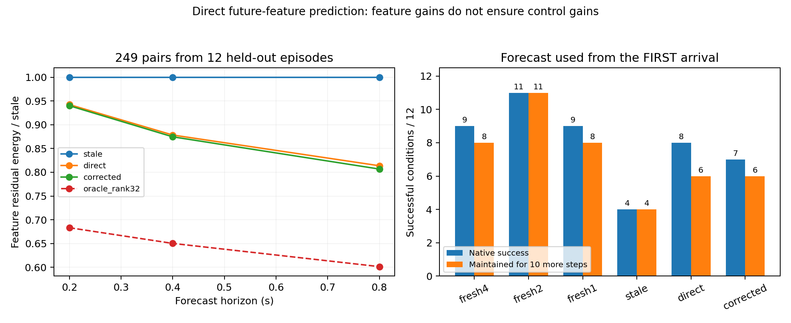

# 도착 feature 직접 예측: 접근 구간을 포함한 재검증

2026-11-17 KST. 동일 GR00T N1.6 / RTX3090 / H50/K16. Predictor 49,216 parameters, rank32; 보정기148,032 parameters. Action expert는 예측 계열 모두 N4를 유지했습니다.

**이번12조건에서 stale 4/12, 직접 예측 8/12, 예측＋보정 7/12, Fresh2 11/12였습니다. 직접 예측은 단순 재사용보다 개선됐지만 강한 Fresh2 기준선을 넘지 못했습니다.** 전체 갱신·준비 포함 계산량은 직접 예측 3.377ms/action, Fresh2 3.366ms/action입니다.

## 왜 다시 평가했나

[첫 파일럿](../direct_features_20261117/RESULTS.md)은 feature/action 오차를 줄였지만, 정밀 구간의 첫 action부터 예측했을 때 Fresh4 10/12 대비 direct5/12, corrected7/12였습니다. 학습이 정밀 phase 시작부터여서 접근→도착 전환이 빠져 있었습니다. 이 결과를 본 뒤 학습 범위를 보완한 탐색적 후속이며, 첫 결과를 삭제하거나 같은 평가 데이터를 새 held-out이라고 재사용하지 않았습니다.

학습 초기 상태0/2/4/6/8/10, 검증1/5는 그대로입니다. **평가는 새 초기 상태12/13/14/15 ×3작업 =12조건**입니다. GR00T pretraining과 겹치지 않는다는 뜻은 아니며, 같은 작업의 새 초기 상태 일반화입니다. 기존 학습·검증24 episode의 action trace와 공통 feature가 모두 정확히 같고, 각 episode에 접근 구간3쌍만 추가됐습니다. 모델 구조·rank·학습 epoch 예산은 변경하지 않았습니다.

첫 파일럿과 후속의 test 조건이 다르므로, 두 실험의 성공 수 변화만으로 학습 보완의 인과적 효과를 계산하지 않습니다. 각 실험 안의 동일 조건 비교를 사용합니다.

데이터: 학습324쌍, 검증114쌍, 평가249쌍. PCA/fit/checkpoint·blend 선택에서 test 파일은 읽지 않았습니다.

## 1. 실제 접촉 구간 제어

접근 prefix에서 이미 정해진16 action으로 도착 feature를 예측하고, **첫 정밀 action부터** 그 feature를 사용했습니다. 모든 최초 예정 action은 origin 관측으로 다시 생성해 정확히 같음을 확인했습니다. 이후2chunk마다 full VLM을 갱신합니다. 실제 미래 simulator rollout은 predictor에 없습니다.

|방법|성공/12|성공 유지/12|계산 ms/action|예측 도착 처리 p50 ms|
|---|---:|---:|---:|---:|
|fresh4|9|8|4.406|—|
|fresh2|11|11|3.366|—|
|fresh1|9|8|2.834|—|
|stale|4|4|3.410|39.17|
|direct|8|6|3.377|39.12|
|corrected|7|6|3.399|39.87|

성공 유지는 chunk 끝부터 zero-motion/same-gripper10step 동안 goal 유지 여부입니다. **동기식 simulator 평가**로, 추론 중 물리는 정지합니다. 실제20Hz deadline/비동기 완료시간을 측정한 결과가 아닙니다. 모든 예측 준비·보정 비용을 계산에 넣었습니다. 미사용 예측도 제외하지 않았습니다.

Fresh4와 둘 다 성공한 동일 조건에서:

|방법|공통 성공 조건|평균action 수 차이|평균계산 시간 차이 ms|Fresh4 대비 성공 승/패|
|---|---:|---:|---:|---:|
|corrected|7|+13.7|-11.92|0/2|
|direct|7|+13.7|-17.99|1/2|
|fresh1|9|-1.8|-111.04|0/0|
|fresh2|9|-1.8|-75.58|2/0|
|stale|4|+56.0|+118.49|0/5|

계산 ms/action 감소가 곧 더 빠른 완료를 의미하지 않습니다. 더 많은 action으로 복구하거나 실패하면 전체 이득이 사라집니다. 소표본 성공률 차이를 통계적으로 확정된 우열로 주장하지 않습니다.

## 2. Feature/action 진단

평가 관측 쌍은 같은 episode 안에서 상관됩니다. 수백 쌍을 수백 개 독립 작업으로 세지 않습니다. Feature 열은 stale residual 에너지 대비 비율, action/translation RMSE는 Fresh4와의 일치도입니다.

|예측 시간|방법|feature 비율|action RMSE|translation RMSE|gripper 일치|예측 준비 p50 ms|
|---|---|---:|---:|---:|---:|---:|
|0.2s|stale|1.000|0.1296|0.1665|0.962|0.051|
|0.2s|direct|0.942|0.1118|0.1319|0.961|0.328|
|0.2s|corrected|0.940|0.1118|0.1316|0.961|0.328|
|0.2s|fresh1|—|0.0867|0.1026|0.970|0.000|
|0.2s|fresh2|—|0.0398|0.0436|0.993|0.000|
|0.2s|oracle_rank32|0.683|0.0727|0.0886|0.980|평가 전용|
|0.4s|stale|1.000|0.2231|0.2947|0.910|0.050|
|0.4s|direct|0.878|0.1736|0.2113|0.921|0.329|
|0.4s|corrected|0.875|0.1722|0.2107|0.924|0.329|
|0.4s|fresh1|—|0.0802|0.0875|0.965|0.000|
|0.4s|fresh2|—|0.0373|0.0392|0.987|0.000|
|0.4s|oracle_rank32|0.650|0.1320|0.1564|0.949|평가 전용|
|0.8s|stale|1.000|0.3456|0.4509|0.777|0.050|
|0.8s|direct|0.814|0.2471|0.2967|0.836|0.326|
|0.8s|corrected|0.807|0.2489|0.2994|0.834|0.326|
|0.8s|fresh1|—|0.0842|0.1029|0.975|0.000|
|0.8s|fresh2|—|0.0345|0.0417|0.997|0.000|
|0.8s|oracle_rank32|0.601|0.1808|0.2190|0.911|평가 전용|

`oracle_rank32`는 **실제 미래 feature 변화의 rank32 투영**을 넣은 평가용 대조군입니다. 예측의 학습 오차를 없애고 현재 저랭크 표현이 남기는 오차를 봅니다. 미래 정답을 사용하므로 실제 controller나 배포 지연 결과가 아니며, closed-loop에는 포함하지 않았습니다. 낮은 feature 오차가 action 최적성을 보장하지 않아 이 대조군도 성공률의 이론적 상한이라고 부르지 않습니다.

Action/translation RMSE는 native decoded action 좌표계의 수치이며 실제 물체 위치의 mm 오차가 아닙니다. 이 파일럿은 접촉·배치·서랍 작업이고 좁은 공차의 peg insertion은 아닙니다.

접근 시작에서 **정밀 구간 도착까지0.8초**인12쌍만 분리하면:

|방법|feature 비율|action RMSE|translation RMSE|gripper 일치|
|---|---:|---:|---:|---:|
|corrected|0.843|0.2844|0.3358|0.771|
|direct|0.850|0.2704|0.3182|0.786|
|fresh1|—|0.1206|0.1398|0.938|
|fresh2|—|0.0429|0.0521|1.000|
|fresh4|—|0.0000|0.0000|1.000|
|oracle_rank32|0.607|0.2028|0.2419|0.885|
|stale|1.000|0.4226|0.5497|0.656|

## 3. 작업별 성공

|작업|방법|성공/4|성공 유지/4|
|---|---|---:|---:|
|KITCHEN_SCENE4_put_the_black_bowl_in_the_bottom_drawer_of_the_cabinet_and_close_it|fresh4|2|2|
|KITCHEN_SCENE4_put_the_black_bowl_in_the_bottom_drawer_of_the_cabinet_and_close_it|fresh2|4|4|
|KITCHEN_SCENE4_put_the_black_bowl_in_the_bottom_drawer_of_the_cabinet_and_close_it|fresh1|2|2|
|KITCHEN_SCENE4_put_the_black_bowl_in_the_bottom_drawer_of_the_cabinet_and_close_it|stale|2|2|
|KITCHEN_SCENE4_put_the_black_bowl_in_the_bottom_drawer_of_the_cabinet_and_close_it|direct|3|3|
|KITCHEN_SCENE4_put_the_black_bowl_in_the_bottom_drawer_of_the_cabinet_and_close_it|corrected|2|2|
|open_the_top_drawer_and_put_the_bowl_inside|fresh4|3|3|
|open_the_top_drawer_and_put_the_bowl_inside|fresh2|3|3|
|open_the_top_drawer_and_put_the_bowl_inside|fresh1|3|3|
|open_the_top_drawer_and_put_the_bowl_inside|stale|1|1|
|open_the_top_drawer_and_put_the_bowl_inside|direct|3|3|
|open_the_top_drawer_and_put_the_bowl_inside|corrected|3|3|
|put_the_cream_cheese_in_the_bowl|fresh4|4|3|
|put_the_cream_cheese_in_the_bowl|fresh2|4|4|
|put_the_cream_cheese_in_the_bowl|fresh1|4|3|
|put_the_cream_cheese_in_the_bowl|stale|1|1|
|put_the_cream_cheese_in_the_bowl|direct|2|0|
|put_the_cream_cheese_in_the_bowl|corrected|2|1|

## 원자료와 재현

[집계](aggregate.json), [검증](validation.json), [설계](../../docs/direct_feature_experiment.md). 하위 폴더에 episode/split hash, training curves, 고정 모델 선택, 모든 offline/rollout row, 실행 소스 snapshot이 있습니다. 영상·feature 데이터와 학습 checkpoint는 로컬 results에 남기고 Git에는 넣지 않았습니다.

설정은 `configs/direct_feature_arrival_probe.json`입니다. 기존 설계의 collect/train/correct/evaluate 명령에서 데이터·모델 출력 경로를 새 것으로 바꾸고, closed 평가에 `--arrival-start`를 붙이면 됩니다. 로컬 결과는 `results/direct_arrival_features_20261117`, `results/direct_arrival_feature_model_20261117`, `results/direct_arrival_feature_corrector_20261117`, `results/direct_feature_arrival_followup_20261117`입니다.

