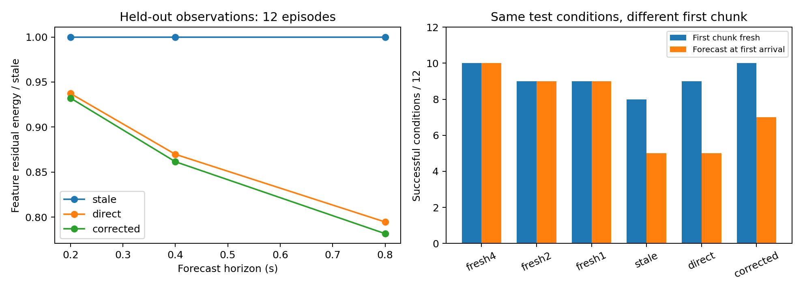

# 미래 VLM feature 직접 예측: 첫 검증

2026-11-17 KST. 기존 GR00T N1.6 / RTX 3090 / H50/K16. **단순 재사용보다 feature/action 오차는 줄었지만, 첫 정밀 action부터 적용한 성공률은 Fresh4 10/12 대비 직접 예측5/12, 보정7/12로 낮았습니다. 가벼운 예측의 실행 가능성과 접촉 품질 달성은 구분해야 합니다.**

36개 teacher episode를 초기 상태별 학습18/검증6/평가12로 분리했습니다. 학습270쌍, 검증96쌍, 평가165쌍입니다. 평가 초기 상태는3/7/9/11이며 작업3종은 학습 때와 같습니다. GR00T 학습 데이터나 이전 실험에서 미관측이었다는 뜻은 아닙니다. Predictor/보정기/PCA/모델 선택에서 평가 episode를 읽지 않았습니다.

## 1. 무엇을 바꿨나

미래 simulator와 GR00T를 실행 중 반복하는 Whole-bank를 제거했습니다. 과거·현재 관측 feature/state와 이미 정해진 action prefix로 **다음 한 시점**을 예측합니다. 약49k 파라미터 predictor와 rank32 고정 basis를 사용했습니다. 고정 basis는 학습 residual의 image-token 에너지 약39.8%를 설명합니다. 도착 보정기는 두 카메라의16×16 RGB 변화와 실제state를 쓰는 약148k MLP입니다. Sparse attention이나 변화 patch만 재계산한 구현은 아닙니다.

모든 예측 계열 action expert는 새 noise에서 N4 전체 계산을 유지합니다. 기존3+1 flow continuation을 섞지 않았습니다. Fresh1/2도 같은 크기의 모델이며 flow 횟수만 다릅니다. Same-feature bypass는 native action과 최대 차이0, backbone 호출0으로 검증했습니다.

## 2. 평가용 미래 관측 쌍에서의 결과

Feature 열은 단순 재사용의 오차 에너지를1로 정규화한 값입니다. Action RMSE는 Fresh4와의 일치도이며 작업 정확도가 아닙니다. 지연은 중앙값(ms), 현재 feature가 이미 있는 상태의 추가 예측 준비와 도착 처리입니다.

|예측 시간|방법|feature 오차 비율|action RMSE|예측 준비|도착 처리|
|---|---|---:|---:|---:|---:|
|0.2s|stale|1.000|0.1470|0.049|35.22|
|0.2s|direct|0.937|0.1157|0.334|34.98|
|0.2s|corrected|0.932|0.1125|0.334|35.69|
|0.2s|fresh1|—|0.0771|0.000|40.36|
|0.2s|fresh2|—|0.0349|0.000|48.57|
|0.2s|fresh4|—|0.0000|0.000|64.22|
|0.4s|stale|1.000|0.2062|0.049|35.22|
|0.4s|direct|0.870|0.1464|0.329|35.04|
|0.4s|corrected|0.862|0.1453|0.329|35.75|
|0.4s|fresh1|—|0.0787|0.000|40.34|
|0.4s|fresh2|—|0.0374|0.000|48.53|
|0.4s|fresh4|—|0.0000|0.000|64.10|
|0.8s|stale|1.000|0.2941|0.049|35.21|
|0.8s|direct|0.795|0.2098|0.330|34.99|
|0.8s|corrected|0.782|0.1954|0.330|35.66|
|0.8s|fresh1|—|0.1033|0.000|40.34|
|0.8s|fresh2|—|0.0602|0.000|48.54|
|0.8s|fresh4|—|0.0000|0.000|64.16|

검증에서 선택한 temporal extrapolation 계수는0으로, 단순 재사용과 동일해졌습니다. Feature predictor는 weighted feature loss만으로 학습했고 action loss를 쓰지 않았습니다. 미래 feature의 평균화와 low-rank 제약이 policy에 미치는 영향은 미해결입니다. Fresh1은 예측 N4보다 낮은 teacher-action 오차를 보였습니다.

## 3. 접촉·배치·서랍 closed-loop

모두 동일한12조건의 paired 평가입니다. 물리가 추론 중 정지하는 **동기 평가**이며, 실제20Hz deadline이나 비동기 완료시간을 측정하지 않았습니다. 각 방식을 phase 종료까지 유지하고 공통 Fresh rescue를 붙이지 않았습니다.

첫 Fresh 방식은 phase의 첫16 action을 Fresh로 만들고 다음 chunk를 예측합니다. 1조건은 첫 chunk에서 끝나 예측을 사용하지 않아, **공통 접근 prefix에서 예측해 첫 정밀 action부터 사용하는 도착 예측 방식**을 추가했습니다. 모델과 하이퍼파라미터는 변경하지 않았습니다. 추가 방식의 첫 예측 origin은 학습 pair의 시작보다16step 빠르므로 이 시점의 분포 차이도 포함합니다. 두 방식 모두 이후2chunk마다 full VLM을 다시 계산합니다.

### 도착 첫 action부터 예측 사용 (12조건 모두 적용)

|방법|성공|0.5초 상당의 성공 유지|실행action당 계산ms|예측 도착 처리p50 ms|
|---|---:|---:|---:|---:|
|fresh4|10/12|9/12|4.292|—|
|fresh2|9/12|9/12|3.321|—|
|fresh1|9/12|8/12|2.804|—|
|stale|5/12|4/12|3.325|39.22|
|direct|5/12|5/12|3.387|39.18|
|corrected|7/12|7/12|3.424|40.02|

준비 비용은 전부 더하고, 쓰이지 않고 종료된 예측도 포함합니다. Action당 계산 감소가 더 적은 action으로 작업을 완료한다는 뜻은 아닙니다. 성공률이 다른 방식의 전체 평균 완료시간만으로 우열을 판단하지 않습니다.

Fresh4와 **둘 다 성공한 동일 조건**에서는:

|방법|공통 성공 조건|평균action 수 차이|평균계산 시간 차이 ms|Fresh4 대비 승/패|
|---|---:|---:|---:|---:|
|corrected|7|+29.7|+43.26|0/3|
|direct|5|+28.8|+56.99|0/5|
|fresh1|8|+0.0|-65.02|1/2|
|fresh2|9|+0.0|-51.03|0/1|
|stale|5|+41.6|+71.08|0/5|

### 첫 chunk는 Fresh, 이후 교대로 예측

|방법|성공|0.5초 상당의 성공 유지|실행action당 계산ms|예측 도착 처리p50 ms|
|---|---:|---:|---:|---:|
|fresh4|10/12|9/12|4.361|—|
|fresh2|9/12|9/12|3.313|—|
|fresh1|9/12|8/12|2.820|—|
|stale|8/12|7/12|3.462|39.20|
|direct|9/12|8/12|3.459|39.25|
|corrected|10/12|9/12|3.553|39.93|

준비 비용은 전부 더하고, 쓰이지 않고 종료된 예측도 포함합니다. Action당 계산 감소가 더 적은 action으로 작업을 완료한다는 뜻은 아닙니다. 성공률이 다른 방식의 전체 평균 완료시간만으로 우열을 판단하지 않습니다.

Fresh4와 **둘 다 성공한 동일 조건**에서는:

|방법|공통 성공 조건|평균action 수 차이|평균계산 시간 차이 ms|Fresh4 대비 승/패|
|---|---:|---:|---:|---:|
|corrected|10|+20.8|+28.85|0/0|
|direct|9|+23.1|+31.65|0/1|
|fresh1|8|+0.0|-66.92|1/2|
|fresh2|9|+0.0|-49.96|0/1|
|stale|8|+26.0|+37.74|0/2|

Fresh1/2/4의36 rollout은 두 방식 사이에 **전체 action trace와 성공 판정이 일치**했습니다. 이는 같은12조건의 반복이며 독립 조건을 늘린 것이 아닙니다. Closed rollout은144회, 고유한 평가 초기 조건은12개입니다.

## 4. 작업별 결과 (도착 첫 action부터 예측)

|작업|방법|성공/4|성공 유지/4|
|---|---|---:|---:|
|KITCHEN_SCENE4_put_the_black_bowl_in_the_bottom_drawer_of_the_cabinet_and_close_it|fresh4|3|3|
|KITCHEN_SCENE4_put_the_black_bowl_in_the_bottom_drawer_of_the_cabinet_and_close_it|fresh2|2|2|
|KITCHEN_SCENE4_put_the_black_bowl_in_the_bottom_drawer_of_the_cabinet_and_close_it|fresh1|1|1|
|KITCHEN_SCENE4_put_the_black_bowl_in_the_bottom_drawer_of_the_cabinet_and_close_it|stale|2|2|
|KITCHEN_SCENE4_put_the_black_bowl_in_the_bottom_drawer_of_the_cabinet_and_close_it|direct|1|1|
|KITCHEN_SCENE4_put_the_black_bowl_in_the_bottom_drawer_of_the_cabinet_and_close_it|corrected|3|3|
|open_the_top_drawer_and_put_the_bowl_inside|fresh4|3|3|
|open_the_top_drawer_and_put_the_bowl_inside|fresh2|3|3|
|open_the_top_drawer_and_put_the_bowl_inside|fresh1|4|4|
|open_the_top_drawer_and_put_the_bowl_inside|stale|2|2|
|open_the_top_drawer_and_put_the_bowl_inside|direct|2|2|
|open_the_top_drawer_and_put_the_bowl_inside|corrected|2|2|
|put_the_cream_cheese_in_the_bowl|fresh4|4|3|
|put_the_cream_cheese_in_the_bowl|fresh2|4|4|
|put_the_cream_cheese_in_the_bowl|fresh1|4|3|
|put_the_cream_cheese_in_the_bowl|stale|1|0|
|put_the_cream_cheese_in_the_bowl|direct|2|2|
|put_the_cream_cheese_in_the_bowl|corrected|2|2|

## 5. 해석과 한계

작은 action-conditioned feature predictor의 구현 가능성은 확인했지만, 일반적인 정밀 삽입 성능이나 PIM 전체의 우위를 보여준 결과는 아닙니다. 낮은 feature MSE만으로 grasp/contact에 중요한 오류를 배제할 수 없습니다. 2chunk마다 full VLM을 갱신하는 비용, 느린 복구 동작, 실패까지 포함해 판단해야 합니다. 약0.33ms의 한 시점 예측을 수초 뒤까지 전체 bank를 만드는 기존 구현과 같은 작업량의 speedup으로 비교하지 않습니다.

다음 단계는 실제 제어 성공을 떨어뜨리는 feature 오류를 분석하고, frozen action expert의 출력 일치를 사용하는 학습을 검증하는 것입니다. 그 다음 실제20Hz 비동기 실행을 평가해야 합니다. 이번 결과만으로 full-VLM 갱신 빈도를 줄이거나 PIM에서의 성공률·속도를 주장하지 않습니다.

## 원자료·재현

[설계·제약](../../docs/direct_feature_experiment.md), [기계 판독 집계](aggregate.json), [검증](validation.json). 각 하위 폴더에 raw rows, 학습 곡선, split/episode hash, 소스 snapshot이 있습니다. 모델 checkpoint와 수집 영상/feature는 로컬 results에 보존하고 Git에서 제외합니다.

```bash
.venv/bin/python scripts/collect_direct_features.py --config configs/direct_feature_probe.json --output results/direct_features_new
.venv/bin/python scripts/train_direct_features.py --data results/direct_features_new --output results/direct_model_new
.venv/bin/python scripts/train_feature_corrector.py --data results/direct_features_new --predictor results/direct_model_new/predictor.pt --output results/direct_corrector_new
.venv/bin/python scripts/evaluate_direct_features.py --data results/direct_features_new --predictor results/direct_model_new/predictor.pt --corrector results/direct_corrector_new/corrector.pt --output results/direct_eval_new --phase offline
.venv/bin/python scripts/evaluate_direct_features.py --data results/direct_features_new --predictor results/direct_model_new/predictor.pt --corrector results/direct_corrector_new/corrector.pt --output results/direct_eval_new --phase closed
.venv/bin/python scripts/evaluate_direct_features.py --data results/direct_features_new --predictor results/direct_model_new/predictor.pt --corrector results/direct_corrector_new/corrector.pt --output results/direct_arrival_new --phase closed --arrival-start
```


