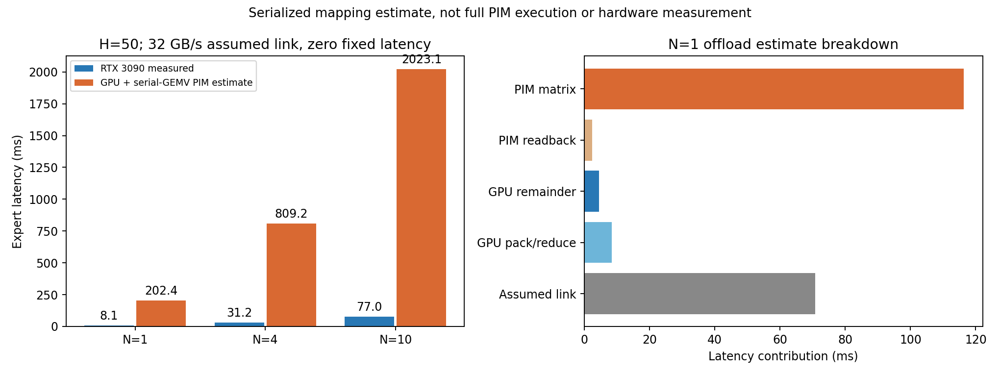

# H=50, N=1·4·10: RTX 3090과 현재 PIM 매핑 비교

2026-11-17 KST. **현재 Samsung PIMSimulator의 토큰 순차 GEMV 매핑에서는 PIM 가속 이득이 없습니다.** 전체 action expert는 GPU에서 직접 실행했습니다. PIM에서는 실제 전체 토큰 batch 크기의 행렬 커널을 시뮬레이션했고, 그 합계에 GPU 잔여 연산과 전송 가정을 더했습니다. **전체 VLA를 PIM에서 실행한 결과나 PIM 보드 실측이 아닙니다.**

## 요청한 비교

모두 같은 GR00T N1.6 LIBERO, batch=1, H=50입니다. N은 flow/denoising 반복 횟수이고 K(실행할 action 수)와 다릅니다. H개의 action latent를 각 반복에서 함께 갱신합니다. H=50 latent는 실제 계산하지만 현재 checkpoint의 공식 decoder는 이 중 16개 action을 반환합니다. 50개의 최종 환경 action을 실행했다는 뜻이 아닙니다.

| N | GPU 전체 expert 실측 p50 | PIM 행렬 연산 합계 | GPU+PIM 전체 expert 추정 |
|---:|---:|---:|---:|
| 1 | 8.06ms | 116.30ms | 202.41ms |
| 4 | 31.16ms | 465.18ms | 809.16ms |
| 10 | 76.99ms | 1162.96ms | 2023.05ms |

PIM 행렬 합계에는 attention·정규화·activation·결과 readback·외부 링크를 넣지 않았습니다. 이 부분만으로도 GPU 전체 expert보다 느립니다. 오른쪽은 행렬을 PIM, 나머지를 GPU에 두는 직렬 분할의 계산값입니다. 링크 **32GB/s, 각 행렬 호출의 고정 왕복 지연 0μs**, 가중치 사전 상주를 가정했습니다. 32GB/s는 실측 장치 연결 속도가 아닙니다. PIM 값은 관측 길이별 계산값의 평균이며, GPU의 실측 p50과 구별해야 합니다.



영상 입력부터 action decoding까지 포함하면 다음과 같습니다. 오른쪽은 위 추정에 관측 처리·decode 실측 중앙값을 더한 값으로, end-to-end 실측 분포가 아닙니다.

| N | GPU 전체 VLA p50 | GPU+PIM 전체 VLA 추정 |
|---:|---:|---:|
| 1 | 40.18ms | 234.56ms |
| 4 | 63.35ms | 841.40ms |
| 10 | 109.13ms | 2055.31ms |

## 측정한 workload와 GPU 방법

- 기존 LIBERO 기록 episode 1274·1269·1285에서 각 4개 관측, 총 12개 관측을 사용했습니다. 외부·손목 영상, state, instruction을 모델에 넣었습니다. 새로운 성공률 rollout은 수행하지 않았습니다.
- 각 N마다 12관측 × 4회 = 48회, 총 144회입니다. 순서를 섞고 CUDA 동기화 wall clock과 CUDA event를 기록했습니다. batch=1, BF16, RTX 3090, PyTorch 2.9.0+cu128. 모델 로딩·가중치 초기 적재는 제외했습니다.
- Expert 구간은 noise 생성, action encoder, 32층 DiT, action decoder, latent 갱신을 포함합니다. 영상/VLM/state fusion은 별도 구간입니다. 파이프라인은 기존 eager 실행이며 CUDA Graph로 최적화한 전체 expert는 아닙니다.
- H=50에 state 토큰 1개를 붙여 self-attention 길이는 51입니다. 이번 12관측에서 cross-attention feature 길이는 **206·207·208**이며 각 길이가 4관측씩입니다. 앞선 다른 실험의 길이 범위를 이번 trace에 섞지 않았습니다.
- 매 flow에 233개 dense projection이 실행됩니다. N=1/4/10에서 각각 233/932/2330개를 실제 추적했고 shape와 순서의 반복 일치를 검사했습니다. State encoder는 expert 바깥입니다. Category-specific 가중치는 선택된 embodiment만 계산합니다.
- GPU p50/p95 및 전체 원자료를 보존했습니다. N=4의 관측 처리에 120.96ms인 한 표본이 있어 전체 VLA 평균은 p50보다 큽니다. 제외하지 않았습니다.

| N | Expert 평균 | Expert p50 | Expert p95 | 전체 VLA 평균 | 전체 VLA p95 |
|---:|---:|---:|---:|---:|---:|
| 1 | 8.06 | 8.06 | 8.15 | 40.22 | 40.58 |
| 4 | 31.19 | 31.16 | 31.61 | 65.30 | 64.34 |
| 10 | 76.93 | 76.99 | 77.70 | 109.17 | 110.08 |

단위 ms. p95는 표본 지연시간의 분위수이며 성공률 또는 추정치의 신뢰구간이 아닙니다.

## PIM 시뮬레이션과 기능 검사

- 기존 Samsung PIMSimulator revision `3703d1f19c8f027360cc33a3243eb271e3bb6898`, 64 logical pseudochannels, 채널당 8 PIM blocks, tCK=1ns, FP16 GEMV입니다. RTX 3090과 면적·전력·메모리 자원을 맞춘 설계 비교는 아닙니다.
- 출력 차원은 4096, 입력 차원은 256의 배수로 padding합니다. 서로 다른 실제 full-batch 물리 shape 12종을 각각 실행했습니다. 단일 GEMV 시간을 50배해 대신한 것이 아닙니다.
- Upstream timing fixture는 batch 입력 버퍼를 한 벡터만 할당했습니다. 자체 driver에서 전체 batch 크기로 보완했습니다. GEMV의 `(j+b)` 출력 주소는 여러 출력 tile과 batch가 겹쳐 `(b*num_output_tiles+j)`로 수정했습니다. 이 수정은 로컬 simulator에 있으며 변경 문자열·hash를 보존했습니다.
- 3벡터 × 8192출력 × 256입력 합성 행렬로 양쪽 bank parity, 16 lanes, 출력 tile·batch 구분을 검사했습니다. **24,576개 출력 모두 일치**, 기존 공식 4096출력 GEMV 검사도 통과했습니다. 실제 GR00T 가중치/activation의 수치 동등성 검사는 아닙니다.
- Timing probe는 dummy data와 상주 가중치를 가정합니다. PIM arithmetic는 FP16이고 GPU 기준은 BF16입니다. 전체 모델의 정밀도·action·작업 성공률 일치를 검증하지 않았습니다.
- 각 shape를 별도 simulator에서 측정한 뒤 trace의 발생 횟수로 합산합니다. N별 독립적인 전체 PIM 모델 실행은 아닙니다. 실제 전체 가중치 주소 배치·base-row relocation은 구현하지 않았고, resident 배치가 가능하다고 가정한 operator 합계입니다.
- 선택된 활성 행렬 가중치는 원래 약 2.20GB, padding 후 약 4.66GB입니다. 이는 용량 계산이며 측정한 DRAM 트래픽이 아닙니다. 최초 적재와 PIM driver/command 발행 비용은 제외했습니다.
- 커널 계산과 readback을 나누어 기록했습니다. **CPU에서 시뮬레이터가 도는 수초~수분을 PIM 지연시간으로 쓰지 않았습니다.** 표의 시간은 cycles × 1ns입니다.

| 벡터 수 | padded [out,in] | PIM 계산 ms | readback ms |
|---:|---:|---:|---:|
| 1 | 4096×256 | 0.001138 | 0.000181 |
| 1 | 4096×1536 | 0.005147 | 0.000181 |
| 50 | 4096×256 | 0.044671 | 0.007206 |
| 50 | 4096×1536 | 0.245713 | 0.007197 |
| 50 | 4096×3072 | 0.486851 | 0.006925 |
| 51 | 4096×1024 | 0.168571 | 0.007064 |
| 51 | 4096×1536 | 0.250503 | 0.007096 |
| 51 | 4096×6144 | 0.987939 | 0.007328 |
| 51 | 8192×1536 | 0.500632 | 0.014345 |
| 206 | 4096×2048 | 1.339393 | 0.029153 |
| 207 | 4096×2048 | 1.346008 | 0.029312 |
| 208 | 4096×2048 | 1.352646 | 0.028793 |

## 전체 expert 추정의 구성

`expert 추정 = PIM 행렬 합계 + PIM readback + GPU 나머지 + GPU input packing/부분합 reduction + 링크 전송 + 호출별 고정 지연`

GPU 나머지는 실제 선형 계층 출력을 저장하고 같은 위치에 재사용하면서 attention·정규화·activation·latent 갱신을 실행해 측정했습니다. 세 길이 × 세 N에서 latent가 원래 실행과 정확히 일치했습니다. 이는 시간 분해용 counterfactual replay이며 실제 PIM backend가 아닙니다. 각 조합 24회 측정의 중앙값을 사용했습니다. GPU 입력 BF16→FP16 복사, 유용한 출력의 16-lane 부분합 합산·BF16 변환·bias도 별도 측정했습니다.

현재 GEMV는 출력마다 16개 FP16 lane 부분합을 반환합니다. padding된 출력 전체를 GPU로 옮겨 유용한 출력의 합산을 수행하는 단순 분할입니다. N=1의 링크 입력+출력은 약 **2.264GB**입니다. 예전의 “expert 전체를 PIM 안에서 끝내고 입력·출력만 한 번 전송”하는 가정과 다른 분할이므로, 그 작은 activation 전송량을 여기 적용할 수 없습니다.

| N | PIM 행렬 | readback | GPU 나머지 | packing/reduction | 가정한 링크 | 합계 |
|---:|---:|---:|---:|---:|---:|---:|
| 1 | 116.30 | 2.35 | 4.55 | 8.46 | 70.76 | 202.41 |
| 4 | 465.18 | 9.42 | 17.71 | 33.83 | 283.02 | 809.16 |
| 10 | 1162.96 | 23.54 | 44.42 | 84.57 | 707.56 | 2023.05 |

단위 ms. GPU와 PIM은 직렬로 수행하고 전송 overlap은 두지 않았습니다. PIM readback은 메모리→컨트롤러, 외부 링크는 컨트롤러→GPU의 별도 구간입니다. 고정 왕복 지연을 10μs로 두면 N=1/4/10에 각각 2.33/9.32/23.30ms가 추가됩니다. DMA buffer 관리, CPU PIM driver, 장치 경합은 미포함입니다. 8/32/128GB/s 및 호출당 0/10/100μs 민감도는 CSV에 있습니다.

## 해석과 다음 검증 대상

**이번 구현에서는 N=1·4·10 모두 GPU가 훨씬 빠릅니다.** H=50 flow 모델은 한 토큰씩 autoregressive 생성하는 모델이 아닙니다. GPU는 여러 토큰의 GEMM에서 가중치를 재사용하는 반면, 현재 PIM kernel은 토큰별 GEMV를 반복하며 상당한 padding을 수행합니다. 추가로 외부 부분합 reduction을 택한 단순 분할은 전송량이 큽니다. N을 늘려도 이 구조적 차이는 사라지지 않았습니다.

이 결과는 PIM 전반의 불가능성을 입증하지 않습니다. 다음 검증 대상은 **토큰 병렬 GEMM 매핑, PIM 내부 reduction, 전송 경계를 줄이는 연산 묶음**입니다. 작은 timestep projection만 선택적으로 offload하는 설계도 전체 행렬 offload와 별도로 평가할 수 있습니다. Cross-attention K/V 캐시를 도입한다면 GPU/PIM 양쪽에 같은 최적화를 적용해야 합니다. 현재 표에는 그 최적화를 넣지 않았습니다.

다른 GPU의 시간은 측정하지 않았으며 사양 비율로 추정하지 않았습니다. 이번 시간 비교만으로 N=10이 더 정확하다거나 미래 feature 예측이 불필요하다고 결론 내릴 수 없습니다.

## 원자료와 재현

- [전체 비교 JSON](comparison.json), [민감도 CSV](comparison.csv), [GPU 144회 원자료](gpu/measurements.jsonl), [GPU 요약](gpu/gpu_summary.json), [연산 trace](gpu/traces.json).
- [PIM 설정·수정·shape 결과](pim/summary.json), [기능 검사](pim/functional.log), [GPU 잔여 연산·부분합 측정](remainder/summary.json), [활성 가중치 용량](workload_audit.json).
- [버전 고정 코드·파일 hash](snapshot.json). 코드와 보고서는 커밋하며 checkpoint·원본 입력 데이터·third-party simulator 전체는 포함하지 않습니다.
- 검증: Python 테스트 45개 + 14 subtests 통과, PIM 기능 검사 2종 통과, 9개 조합 replay parity 및 N별 shape 순서 검사 통과.

기존 환경 설치는 [PIM 실행 문서](../../docs/pim_simulation.md)를 따릅니다. 새 출력 디렉터리에서 다음을 실행합니다.

```bash
.venv/bin/python scripts/profile_h50_flow_steps.py --output results/h50_run/gpu
.venv/bin/python scripts/profile_h50_offload_remainder.py --trace results/h50_run/gpu/traces.json --output results/h50_run/remainder
.venv/bin/python scripts/run_pim_h50_trace.py --trace results/h50_run/gpu/traces.json --output results/h50_run/pim
.venv/bin/python scripts/summarize_h50_pim.py --directory results/h50_run
```
