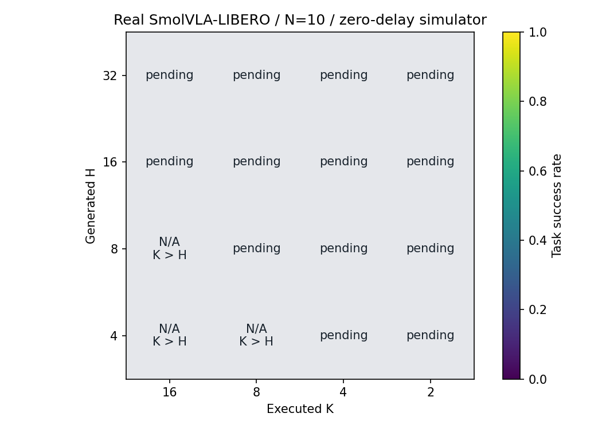

# H/K matrix and prior diagnosis

상태: **running / prior_diagnostics**. 갱신 UTC: 2026-11-17T02:55:03.959823+00:00.
Closed-loop 완료 **0/78**. SmolVLA-LIBERO **cpu / float32**, N=10. PIM 측정이 아닙니다. `cpu_call_*` 필드는 이전 버전과 호환되는 이름이며 실제 장치는 manifest의 device를 확인합니다. CUDA는 stage 경계에서 동기화해 측정합니다.

## H/K 16칸 중 13개 유효 조합

H=[32, 16, 8, 4], K=[16, 8, 4, 2]. K>H 3칸은 N/A이며 실패율에 넣지 않습니다. Action 반복·padding·추가 chunk 생성으로 K의 의미를 바꾸지 않습니다.

| H | K | applicable | completed | planned | successes | success_rate | wilson_ci95 | cpu_call_p50_ms | generation_utilization | errors_or_censored |
|---|---|---|---|---|---|---|---|---|---|---|
| 32 | 16 | True | 0 | 6 | 0 | None | [None, None] | None | None | 0 |
| 32 | 8 | True | 0 | 6 | 0 | None | [None, None] | None | None | 0 |
| 32 | 4 | True | 0 | 6 | 0 | None | [None, None] | None | None | 0 |
| 32 | 2 | True | 0 | 6 | 0 | None | [None, None] | None | None | 0 |
| 16 | 16 | True | 0 | 6 | 0 | None | [None, None] | None | None | 0 |
| 16 | 8 | True | 0 | 6 | 0 | None | [None, None] | None | None | 0 |
| 16 | 4 | True | 0 | 6 | 0 | None | [None, None] | None | None | 0 |
| 16 | 2 | True | 0 | 6 | 0 | None | [None, None] | None | None | 0 |
| 8 | 16 | False | 0 | 0 | 0 | None | [None, None] | None | None | 0 |
| 8 | 8 | True | 0 | 6 | 0 | None | [None, None] | None | None | 0 |
| 8 | 4 | True | 0 | 6 | 0 | None | [None, None] | None | None | 0 |
| 8 | 2 | True | 0 | 6 | 0 | None | [None, None] | None | None | 0 |
| 4 | 16 | False | 0 | 0 | 0 | None | [None, None] | None | None | 0 |
| 4 | 8 | False | 0 | 0 | 0 | None | [None, None] | None | None | 0 |
| 4 | 4 | True | 0 | 6 | 0 | None | [None, None] | None | None | 0 |
| 4 | 2 | True | 0 | 6 | 0 | None | [None, None] | None | None | 0 |

같은 3 task × 2 initial states를 새로 실행합니다. 이전 batch 결과를 복사하지 않습니다. Simulator는 추론 중 정지하므로 제어 품질 평가입니다. Short H는 재학습하지 않은 조건입니다. 작은 표본의 최대 성공률을 최적 설정으로 확정하지 않습니다. SmolVLA causal attention의 공통 prefix 성질은 GR00T와 다를 수 있습니다.

## Prior가 나빠진 원인: 관측과 보정 방식을 분리

| prior_condition | method | post_steps | cases | expert_nmse | teacher_nmse | gripper_accuracy |
|---|---|---|---|---|---|---|
| arrival_rgb_arrival_state | continue_intermediate | 2 | 10 | 0.59597 | 0 | 0.75 |
| arrival_rgb_arrival_state | fresh_split_identity | 2 | 10 | 0.59597 | 0 | 0.75 |
| arrival_rgb_arrival_state | prior_unmodified | 0 | 10 | 0.59597 | 0 | 0.75 |
| arrival_rgb_arrival_state | renoise_independent_noise | 2 | 10 | 0.6456 | 0.036951 | 0.75 |
| arrival_rgb_arrival_state | renoise_original_noise | 2 | 10 | 0.66714 | 0.010108 | 0.75 |
| arrival_rgb_predicted_state | continue_intermediate | 2 | 10 | 0.62236 | 0.0077222 | 0.75 |
| arrival_rgb_predicted_state | prior_unmodified | 0 | 10 | 0.62659 | 0.0099779 | 0.75 |
| arrival_rgb_predicted_state | renoise_independent_noise | 2 | 10 | 0.67691 | 0.044436 | 0.75 |
| arrival_rgb_predicted_state | renoise_original_noise | 2 | 10 | 0.70332 | 0.024952 | 0.75 |
| none | fresh_few | 2 | 10 | 0.4615 | 0.039828 | 0.75 |
| none | fresh_full | 10 | 10 | 0.59597 | 0 | 0.75 |
| stale_rgb_arrival_state | continue_intermediate | 2 | 10 | 0.60479 | 0.11481 | 0.7 |
| stale_rgb_arrival_state | prior_unmodified | 0 | 10 | 0.60481 | 0.1207 | 0.7 |
| stale_rgb_arrival_state | renoise_independent_noise | 2 | 10 | 0.65111 | 0.15162 | 0.7 |
| stale_rgb_arrival_state | renoise_original_noise | 2 | 10 | 0.6695 | 0.12376 | 0.7 |
| stale_rgb_predicted_state | continue_intermediate | 2 | 10 | 0.61236 | 0.10688 | 0.725 |
| stale_rgb_predicted_state | prior_unmodified | 0 | 10 | 0.61574 | 0.11427 | 0.725 |
| stale_rgb_predicted_state | renoise_independent_noise | 2 | 10 | 0.66236 | 0.14421 | 0.725 |
| stale_rgb_predicted_state | renoise_original_noise | 2 | 10 | 0.6858 | 0.12202 | 0.725 |
| stale_rgb_stale_state | continue_intermediate | 2 | 10 | 0.6633 | 0.143 | 0.7 |
| stale_rgb_stale_state | prior_unmodified | 0 | 10 | 0.66951 | 0.15606 | 0.7 |
| stale_rgb_stale_state | renoise_independent_noise | 2 | 10 | 0.71529 | 0.18086 | 0.7 |
| stale_rgb_stale_state | renoise_original_noise | 2 | 10 | 0.74053 | 0.16229 | 0.7 |

| contrast | metric | cases | episodes | mean_delta | ci95 |
|---|---|---|---|---|---|
| replace_RGB_at_actual_state | expert_nmse | 10 | 3 | -0.00052802 | [-0.0188530832529068, 0.009211848179499308] |
| replace_RGB_at_actual_state | teacher_nmse | 10 | 3 | -0.10962 | [-0.17349276365712285, -0.005434525354454915] |
| replace_RGB_at_predicted_state | expert_nmse | 10 | 3 | 0.017175 | [0.013319611549377441, 0.020654987543821335] |
| replace_RGB_at_predicted_state | teacher_nmse | 10 | 3 | -0.095796 | [-0.17806902093191943, -0.0007979441434144974] |
| replace_state_at_stale_RGB | expert_nmse | 10 | 3 | -0.023526 | [-0.0864240328470866, 0.048721954226493835] |
| replace_state_at_stale_RGB | teacher_nmse | 10 | 3 | -0.0024991 | [-0.04452419622490803, 0.03985512116923928] |
| independent_noise_same_observation | expert_nmse | 10 | 3 | -0.024224 | [-0.05755409598350525, 0.002688039094209671] |
| independent_noise_same_observation | teacher_nmse | 10 | 3 | 0.026975 | [0.025652822572737932, 0.027663896636416514] |
| self_renoise_vs_original_fresh | expert_nmse | 10 | 3 | 0.073267 | [0.05227414891123772, 0.09509328007698059] |
| self_renoise_vs_original_fresh | teacher_nmse | 10 | 3 | 0.010359 | [0.00785070052370429, 0.013127267205466827] |
| forecast_renoise_vs_fresh_2step | expert_nmse | 10 | 3 | 0.23669 | [0.11276070028543472, 0.3247581322987874] |
| forecast_renoise_vs_fresh_2step | teacher_nmse | 10 | 3 | 0.08199 | [-0.0282689252247413, 0.1902162985255321] |
| forecast_continue_vs_renoise | expert_nmse | 10 | 3 | -0.076251 | [-0.10854463775952657, -0.048078831285238266] |
| forecast_continue_vs_renoise | teacher_nmse | 10 | 3 | -0.015746 | [-0.024289102603991825, -0.009681789437308908] |

차이는 앞 조건−뒤 조건이며 NMSE는 음수면 앞 조건이 유리합니다. 독립 episode 단위 paired bootstrap이며, 3 episode 미만이면 CI를 표시하지 않습니다. 2-step 조건 외에 4/8-step 비교는 `prior_diagnostics_summary.json`, grasp 직전/직후 및 이동 구간별 결과는 `prior_diagnostics_by_phase.json`에 있습니다.

- 이미지: stale RGB vs 실제 arrival RGB. State: predicted vs 실제 arrival state. 실제 미래 관측을 prior에 넣은 조건은 **privileged 진단**입니다.
- `renoise_original_noise`: 기존 방식. 완성 prior와 원래 noise를 섞어 중간 flow time에서 다시 시작합니다.
- `renoise_independent_noise`: 다른 noise로 같은 방식을 반복하여 noise와 prior의 상관 영향을 분리합니다.
- `continue_intermediate`: 완성 action을 다시 섞지 않고 실제 중간 latent를 이어 계산합니다.
- `fresh_split_identity`: 같은 관측에서 중간 latent를 이어 계산했을 때 원래 full 결과와 일치해야 합니다.
- 같은 실제 관측의 prior조차 재보정하면 나빠지는지 먼저 확인합니다. 그것이 관찰되면 오래된 이미지만으로 모든 차이를 설명할 수 없습니다.

이 진단은 **미래 좌표에서 feature를 생성하는 모델을 구현한 실험이 아닙니다**. 정답 미래 RGB의 효용을 먼저 측정하는 oracle 조건을 포함합니다. 좌표만으로 미래 wrist RGB가 결정되지는 않으며, 미래 camera pose·scene geometry·가림을 다룰 표현이 필요합니다. Offline action NMSE는 정밀 조작 성공률이 아닙니다.

원자료: [closed_loop.jsonl](closed_loop.jsonl), [prior trials](prior_diagnostics/trials.jsonl), [status](status.json), [manifest](manifest.json), [오류](errors.jsonl). GIF는 `replays/`에 저장합니다. 오류/시간 예산 중단은 task 실패와 분리합니다.
