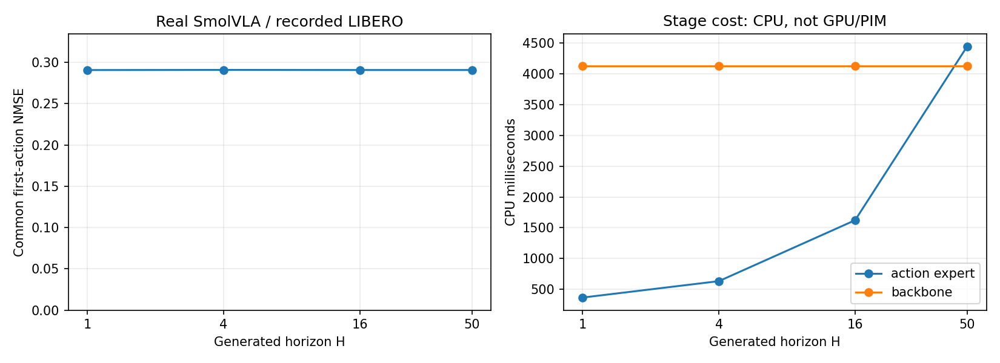

# VLA 로컬 실제 평가 — 내일 확인할 결과

갱신(KST): 2026-11-17T06:49:47.746927+09:00
실행 상태: **finished / done**, offline 완료 24/24.
PID: 19584. 모델은 SmolVLA-LIBERO, native H=50/N=10, CPU float32입니다. GTX 1650/RTX 3090 성능 결과가 아닙니다.

## 현재 결과가 말하는 것

- 현재 72개의 짧은 H/관측 조합에서 native H=50 대비 공통 첫 action의 최대 NMSE는 7.45e-06입니다.

- 이 버전 SmolVLA의 action attention은 causal mask를 사용합니다. 수학적으로 같은 prefix noise와 조건에서 앞 action은 뒤 action에 의존하지 않습니다. 실제 tensor 길이에 따른 수치 차이는 위 NMSE로 남깁니다. H 단축의 주 효과와 K 단축의 피드백 효과를 나누어 봐야 하며, GR00T에도 같은 불변성이 있다고 가정하지 않습니다.

- C_ridge−B_ridge의 expert NMSE 차이는 -0.001637, episode bootstrap 95% 구간 [-0.07277742028236389, 0.05105418711900711]입니다. 독립 episode 3개 pilot이며, 이 결과를 강한 Small VLA나 GR00T의 결론으로 확대하지 않습니다.

- 현재 이 작은 보정기의 held-out 표본에서는 prior가 더 정확하다는 근거가 없습니다. 학습량·보정기 능력·forecast 오차를 분리해서 확인해야 합니다.

- Closed-loop는 같은 공식 초기 상태를 H/K마다 재사용합니다. 아직 완료되지 않은 조합은 서로 다른 표본 수일 수 있으므로, 최종 paired 비교는 공통 완료 상태만 사용해야 합니다.

- H=4에서 action expert는 CPU 총 추론 시간의 13.3%입니다. 다른 단계 비용을 그대로 두고 expert 비용만 0으로 만드는 CPU상의 이상적 속도 향상 상한도 1.15배입니다. GPU/PIM 결과는 아니지만, GPU에서 backbone까지 포함한 stage 비중을 확인해야 하는 이유입니다.

## 1. 선행 계산 + 작은 보정

### 동일한 reaching 후 실제 도착 상태에서 비교한 rollout

| method | completed_tasks | successes | success_rate | wilson_ci95 | errors_or_censored | post_cpu_ms | analytical_cpu_first_delay_ms |
|---|---|---|---|---|---|---|---|
| A_fresh | 3 | 2 | 0.66667 | [0.2076596008020477, 0.9385080552796037] | 0 | 7491.4 | 7491.4 |
| B_few_steps | 3 | 2 | 0.66667 | [0.2076596008020477, 0.9385080552796037] | 0 | 4479 | 4479 |
| B_ridge | 3 | 2 | 0.66667 | [0.2076596008020477, 0.9385080552796037] | 0 | 2.3535 | 2.3535 |
| C_flow_refine | 3 | 2 | 0.66667 | [0.2076596008020477, 0.9385080552796037] | 0 | 4363.3 | 11719 |
| C_ridge | 3 | 2 | 0.66667 | [0.2076596008020477, 0.9385080552796037] | 0 | 2.4143 | 7357.9 |
| D_partial | 3 | 2 | 0.66667 | [0.2076596008020477, 0.9385080552796037] | 0 | 4454.2 | 11024 |

같은 task/도착 상태가 양쪽 모두 완료된 비교:

| candidate | reference | matched_states | success_rate_delta |
|---|---|---|---|
| C_ridge | B_ridge | 3 | 0 |
| C_flow_refine | B_few_steps | 3 | 0 |
| D_partial | A_fresh | 3 | 0 |

현재 관측에서 알려진 reaching action 4개의 controller 목표 변화로 예상 도착 pose를 만들고, 과거 RGB와 결합해 prior를 계산합니다. 실제 미래 state/image는 prior 입력으로 사용하지 않습니다. 같은 초기 상태에서 동일한 reaching action을 재생해 도착 상태가 일치하는지 검증합니다. 물체 위치를 이용한 pre-grasp 구간 선택은 evaluator의 oracle 주석이며, 배포 가능한 구간 감지기를 검증한 것은 아닙니다.

각 방법은 도착 직후 첫 4개 action만 다르게 실행하고 이후에는 같은 Heavy controller를 사용합니다. 따라서 이 표는 **arrival-only intervention**이며 전체 fine manipulation을 Small만으로 수행하는 시스템이 아닙니다. CPU 선행 계산이 reaching의 200 ms를 초과하면 그 나머지를 analytical first delay에 포함합니다. 실제 concurrent 측정은 아닙니다. Replay는 `arrival_replays/`, 원자료는 `arrival_closed_loop.jsonl`입니다.

### 도착 위치 예측을 개선한 별도 조건

| method | completed_tasks | successes | success_rate | wilson_ci95 | forecast_error_mm | post_cpu_ms | errors_or_censored |
|---|---|---|---|---|---|---|---|
| A_fresh | 3 | 2 | 0.66667 | [0.2076596008020477, 0.9385080552796037] | None | 7491.4 | 0 |
| B_few_steps | 3 | 2 | 0.66667 | [0.2076596008020477, 0.9385080552796037] | None | 4479 | 0 |
| B_ridge | 3 | 2 | 0.66667 | [0.2076596008020477, 0.9385080552796037] | None | 2.3535 | 0 |
| C_flow_refine | 3 | 2 | 0.66667 | [0.2076596008020477, 0.9385080552796037] | 8.5291 | 4530.7 | 0 |
| C_ridge | 3 | 1 | 0.33333 | [0.06149194472039621, 0.7923403991979522] | 8.5291 | 2.3909 | 0 |
| D_partial | 3 | 2 | 0.66667 | [0.2076596008020477, 0.9385080552796037] | 8.5291 | 4606.5 | 0 |

같은 reaching 경로에서 과거 4 step으로만 추정한 command gain으로 위치를 예측하고, 회전은 마지막 관측 SO(3) 속도로 예측합니다. 미래 관측은 입력하지 않습니다. A/B의 행동은 prior를 사용하지 않으므로 앞 표의 동일 baseline rollout을 재사용하고 원자료에 출처를 표시합니다. Prior를 사용하는 C/D만 다시 실행합니다. 이 조건도 첫 4 action 개입이며, 원자료·GIF·오류는 `arrival_calibrated/`에 따로 보존합니다.

### 보정 직후 실제 EEF 위치·회전의 fresh A 대비 차이

| forecast | method | tasks | teacher_position_error_mm | teacher_rotation_error_deg | within_2mm | within_5mm |
|---|---|---|---|---|---|---|
| past_calibrated_command | A_fresh | 3 | 0 | 0 | 1 | 1 |
| past_calibrated_command | B_few_steps | 3 | 1.3609 | 0.39729 | 1 | 1 |
| past_calibrated_command | B_ridge | 3 | 19.274 | 1.3322 | 0 | 0 |
| past_calibrated_command | C_flow_refine | 3 | 4.8973 | 0.53818 | 0 | 0.66667 |
| past_calibrated_command | C_ridge | 3 | 22.531 | 1.8548 | 0 | 0 |
| past_calibrated_command | D_partial | 3 | 4.401 | 0.43205 | 0.33333 | 0.66667 |
| target_sum | A_fresh | 3 | 0 | 0 | 1 | 1 |
| target_sum | B_few_steps | 3 | 1.3609 | 0.39729 | 1 | 1 |
| target_sum | B_ridge | 3 | 19.274 | 1.3322 | 0 | 0 |
| target_sum | C_flow_refine | 3 | 3.1237 | 0.72597 | 0.66667 | 0.66667 |
| target_sum | C_ridge | 3 | 23.548 | 1.7217 | 0 | 0 |
| target_sum | D_partial | 3 | 2.8049 | 0.54998 | 0.33333 | 0.66667 |

동일 도착 상태에서 첫 4 action을 실제로 실행한 endpoint를 fresh A의 endpoint와 비교합니다. 이 mm/degree는 **teacher 동작과의 일치도**이며 물체의 정답 grasp pose 오차가 아닙니다. 이후 Heavy가 복구해서 최종 task 성공이 같아지는 경우에도 첫 개입의 차이를 볼 수 있습니다. `arrival_endpoints.jsonl`에 실제 endpoint를 저장합니다.

### Offline 관측의 action 오차

| method | observations | episodes | expert_nmse | teacher_nmse | gripper_accuracy | post_cpu_ms |
|---|---|---|---|---|---|---|
| A_fresh | 12 | 3 | 0.52729 | 0 | 0.79167 | 8323.6 |
| B_few_steps | 12 | 3 | 0.40631 | 0.037038 | 0.79167 | 4918.8 |
| B_ridge | 12 | 3 | 0.67973 | 0.25414 | 0.77083 | 2.053 |
| C_flow_refine | 12 | 3 | 0.60635 | 0.10305 | 0.77083 | 4889.2 |
| C_ridge | 12 | 3 | 0.67809 | 0.26424 | 0.75 | 2.0944 |
| C_shuffled_ridge | 12 | 3 | 0.68577 | 0.29247 | 0.77083 | None |
| D_partial | 12 | 3 | 0.53607 | 0.089683 | 0.77083 | 4881.3 |
| forecast_prior | 12 | 3 | 0.53849 | 0.09602 | 0.77083 | 0 |
| oracle_proprio_prior | 12 | 3 | 0.52873 | 0.10151 | 0.75 | 0 |
| stale_prior | 12 | 3 | 0.58722 | 0.13825 | 0.75 | 0 |

`forecast_prior`: 4 frame 전 RGB + 과거 두 state의 등속 외삽. `stale_prior`: 과거 RGB/state 그대로. `oracle_proprio_prior`: 실제 미래 state + 과거 RGB인 privileged 진단 조건. `A_fresh`: 실제 도착 RGB/state로 처음부터 생성.

`C_flow_refine`: 완성 prior를 다시 noise와 섞고 최신 관측에서 2 step refine. `D_partial`: 과거 조건 8 step + 최신 조건 2 step. 두 방법은 최신 VLM 인코딩 비용을 포함합니다. `B_few_steps`: 최신 조건에서 noise부터 2 step.

`B_ridge/C_ridge`: 동일 가중치의 저비용 회귀기. 3 train episode에서 fresh teacher action을 학습하고 다른 3 episode에서 평가합니다. 강한 Small 모델과의 비교는 아직 필요합니다.

| comparison | metric | episodes | mean_delta | ci95 |
|---|---|---|---|---|
| C_ridge - B_ridge | normalized_action_mse | 3 | -0.0016369 | [-0.07277742028236389, 0.05105418711900711] |
| C_ridge - B_ridge | teacher_nmse | 3 | 0.010103 | [-0.07973518967628479, 0.1444637756794691] |
| C_ridge - B_ridge | gripper_accuracy | 3 | -0.020833 | [-0.0625, 0.0625] |
| C_flow_refine - B_few_steps | normalized_action_mse | 3 | 0.20004 | [0.11276070028543472, 0.2621923200786114] |
| C_flow_refine - B_few_steps | teacher_nmse | 3 | 0.066008 | [-0.025828096317127347, 0.13983008381910622] |
| C_flow_refine - B_few_steps | gripper_accuracy | 3 | -0.020833 | [-0.0625, 0.0] |
| D_partial - A_fresh | normalized_action_mse | 3 | 0.0087779 | [-0.025673553347587585, 0.04417455196380615] |
| D_partial - A_fresh | teacher_nmse | 3 | 0.089683 | [0.0050091848243027925, 0.1558002115925774] |
| D_partial - A_fresh | gripper_accuracy | 3 | -0.020833 | [-0.0625, 0.0] |
| forecast_prior - A_fresh | normalized_action_mse | 3 | 0.011194 | [-0.02373071387410164, 0.05109039321541786] |
| forecast_prior - A_fresh | teacher_nmse | 3 | 0.09602 | [0.005945899814832956, 0.1642896457342431] |
| forecast_prior - A_fresh | gripper_accuracy | 3 | -0.020833 | [-0.0625, 0.0] |
| C_ridge - C_shuffled_ridge | normalized_action_mse | 3 | -0.0076763 | [-0.09749247506260872, 0.07307853549718857] |
| C_ridge - C_shuffled_ridge | teacher_nmse | 3 | -0.028225 | [-0.15574456565082073, 0.11904038209468126] |
| C_ridge - C_shuffled_ridge | gripper_accuracy | 3 | -0.020833 | [-0.125, 0.0625] |

## 예상 좌표에서 feature를 만들면 되는가?

현재 forecast state 외삽 오차:

| cases | mean_mm | median_mm | p95_mm | max_mm |
|---|---|---|---|---|
| 24 | 8.0581 | 7.3103 | 14.849 | 21.525 |

이 값은 **도착 state 예측 오차**이며 action 실행 후 정밀도 mm가 아닙니다. EEF 좌표만으로 미래 손목 카메라 이미지는 결정되지 않습니다. Joint configuration, object geometry와 가림도 필요합니다. 오늘의 stale-RGB+예측-state는 현실적인 출발점 하나이며, 미래 시각 feature가 정확하다고 가정하지 않습니다. `oracle_proprio_prior`와 A의 차이는 state가 맞아도 남는 시각 조건 차이를 진단합니다. 실제 미래 이미지를 사전 입력으로 사용해 성능을 올리는 것은 배포 가능한 방법이 아닙니다.

### 실제 reaching에서 좌표 예측기 추가 진단

| method | tasks | overlapping_windows | mean_mm | p95_mm | selected_arrival_mean_mm |
|---|---|---|---|---|---|
| constant_velocity | 3 | 67 | 8.144 | 16.514 | 11.823 |
| controller_target_sum | 3 | 67 | 123.99 | 151.47 | 121.36 |
| past_calibrated_command | 3 | 67 | 5.7075 | 12.699 | 8.5291 |
| stale_pose | 3 | 67 | 42.312 | 50.985 | 40.761 |

이미 저장한 reaching 경로를 재생해 4 step 뒤의 실제 위치와 비교합니다. Controller 목표 delta의 합, 과거 속도 외삽, 과거 4 step으로만 보정한 command gain을 비교합니다. 미래 simulator state는 채점에만 사용합니다. 겹치는 window는 독립 trial이 아닙니다. 이 진단은 현재 rollout의 prior 생성기를 교체하지 않습니다. Controller 목표를 achieved pose로 취급해서 생기는 오차와 보정 정책 자체의 실패를 구분하기 위한 결과입니다.

## 2. 생성 H와 실행 K

| H | observations | episodes | first_action_nmse | teacher_prefix_nmse | ae_cpu_ms | backbone_cpu_ms |
|---|---|---|---|---|---|---|
| 1 | 24 | 6 | 0.29066 | 2.4655e-06 | 364.61 | 4128.7 |
| 4 | 24 | 6 | 0.29083 | 7.6085e-07 | 631.38 | 4128.7 |
| 16 | 24 | 6 | 0.2907 | 0 | 1622 | 4128.7 |
| 50 | 24 | 6 | 0.2907 | 0 | 4446.3 | 4128.7 |

CPU stage 비중과 AE만 가속할 때의 비용 상한:

| H | end_to_end_cpu_ms | ae_cpu_fraction | zero_ae_cpu_speedup_bound |
|---|---|---|---|
| 1 | 4496.8 | 0.081082 | 1.0882 |
| 4 | 4763.6 | 0.13254 | 1.1528 |
| 16 | 5754.2 | 0.28188 | 1.3925 |
| 50 | 8578.5 | 0.51831 | 2.076 |

`zero_ae_cpu_speedup_bound = total / (total − AE)`는 다른 단계와 호출 횟수를 고정한 이상적 CPU 비용 계산입니다. PIM 성능 예측이나 GPU memory-bound 판정이 아닙니다.

H 단축은 실제 expert tensor 길이를 바꾼 실험입니다. N=10과 공통 초기 noise prefix를 유지합니다. Native 이외 길이는 재학습하지 않은 조건입니다. K의 피드백 효과는 아래 live simulator 결과에서만 판단합니다.

## 실제 LIBERO closed-loop

| H | K | episodes | successes | success_rate | wilson_ci95 | errors_or_censored | mean_sim_steps | cpu_call_p50_ms | cpu_call_p95_ms |
|---|---|---|---|---|---|---|---|---|---|
| 4 | 1 | 6 | 1 | 0.16667 | [0.030053369748306635, 0.5635028221864702] | 0 | 201.5 | 4401.9 | 4701.3 |
| 4 | 4 | 6 | 4 | 0.66667 | [0.299993315138392, 0.9032285888942195] | 0 | 139.33 | 4402.7 | 4702.3 |
| 16 | 4 | 6 | 6 | 1 | [0.6096657120978346, 1.0] | 0 | 95.667 | 5291 | 5635.8 |
| 50 | 1 | 6 | 1 | 0.16667 | [0.030053369748306635, 0.5635028221864702] | 0 | 202 | 8012.3 | 8376.2 |
| 50 | 4 | 6 | 5 | 0.83333 | [0.43649717781352987, 0.9699466302516935] | 0 | 120 | 8052 | 8355.5 |
| 50 | 10 | 6 | 3 | 0.5 | [0.1876163064826506, 0.8123836935173494] | 0 | 156.5 | 8008.9 | 8348.6 |

같은 task/초기 상태가 양쪽 모두 완료된 결과만 비교:

| candidate | reference | matched_initial_states | success_rate_delta |
|---|---|---|---|
| (4, 1) | (50, 1) | 6 | 0 |
| (4, 4) | (50, 4) | 6 | -0.16667 |
| (16, 4) | (50, 4) | 6 | 0.16667 |
| (50, 1) | (50, 10) | 6 | -0.33333 |
| (50, 4) | (50, 10) | 6 | 0.33333 |

Task 0/1/2, 공식 초기 상태 0/1, H/K 여섯 조합을 최대 7시간 동안 실행합니다. 20 Hz simulator는 추론 중 정지하므로 이는 **지연을 제거한 품질 실험**입니다. 완료 실패, 시간 예산에 따른 censored, 실행 오류를 구분합니다. GIF는 `replays/`, 진행 중 화면은 `latest_view.png`입니다.

## 추가로 기록한 지표

- Translation/rotation command MSE, gripper sign 정확도, action 범위 초과 비율.
- Fresh teacher와의 차이, 다른 episode prior를 넣는 대조군, episode 단위 paired bootstrap.
- CPU backbone/AE 시간, call p50/p95, policy 호출 수, 실행 step 수.
- 매 제어 step에서 측정한 EEF 경로 길이·jerk, command 불연속성, sampled contact 수. 정상 grasp 접촉을 모두 충돌 실패로 분류하지 않습니다.

## 다음 연구 판단

1. C가 B보다 유리한지, 그리고 그 이득이 weak Ridge baseline 때문에 생긴 것인지 분리합니다. Task 성공 검증 전에는 작은 action 오차를 정밀 조작 성공으로 부르지 않습니다.
2. 작은 H에서 같은 prefix가 유지되면 H는 정확도보다 낭비와 실행 비용을 줄이는 knob일 수 있습니다. K를 줄였을 때 실제 성공률과 부드러움이 어떻게 바뀌는지 봅니다.
3. Forecast와 exact-state 진단의 차이가 작고 A와 차이가 크면 미래 시각 feature가 주요 문제일 가능성이 있습니다. 반대라면 도착 상태 예측/좌표계 보정부터 개선합니다.
4. RTX 3090 연결 후 π0.5/GR00T native baseline, GPU tensor shape·DRAM traffic·p95/p99·deadline 및 concurrent 경합을 측정합니다. CPU 시간만으로 PIM speedup을 주장하지 않습니다.

LIBERO Spatial의 bowl grasp/place 성공은 좁은 공차의 insertion 정밀도를 입증하지 않습니다. 이 pilot으로 방법을 선별한 뒤, 실제 정밀 작업과 도착 오차 2/5/10/20 mm·회전 perturbation에서 검증해야 합니다. A는 이 checkpoint의 fresh 기준선이며 정확도의 수학적 상한이 아닙니다. B_few_steps는 작은 parameter 모델이 아니라 같은 모델의 적은 flow step 조건입니다.

원자료: [offline.jsonl](offline.jsonl), [도착 후 rollout](arrival_closed_loop.jsonl), [H/K rollout](closed_loop.jsonl), [status.json](status.json), [manifest.json](manifest.json), [세부 보고서](REPORT.md). 미완료/오류가 있으면 `errors.jsonl`과 상위 폴더의 stderr log를 확인하세요.
