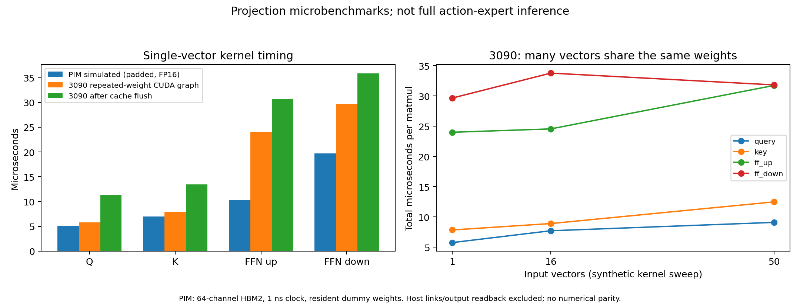

# PIM 시뮬레이션과 RTX 3090 projection 커널 직접 비교

2026-11-17 KST. **단일 벡터 커널에서는 조건부 PIM 이득이 보이지만, 전체 action expert의 가속률은 아직 알 수 없습니다.** GPU 실행 방식과 여러 토큰의 가중치 재사용을 고려하면 단일 GEMV 비교보다 이득이 줄어들 수 있습니다.

## 측정 범위

앞선 [Samsung PIM 시뮬레이션](../../docs/pim_simulation.md)의 Q/K/FFN shape를 입력으로 사용했습니다. GPU에서 같은 논리적 shape와 PIM 패딩 shape 각각을 FP16/BF16, 입력 벡터 1/16/50개로 실행했습니다. 총 48조건 × 순서를 바꾼 3회 = 144개 case run이며, 각 타이밍 모드는 조건당 120개 표본을 보존했습니다. 단일 RTX 3090에서 PyTorch `mm(X, W.T, out=Y)`를 실행했습니다. 할당·입출력 전송·가중치 적재는 측정 밖입니다.

PIM은 64채널, 채널당 8 block, tCK=1ns의 HBM2 설정입니다. FP16 타이밍용 dummy data를 사용한 단일 벡터 연산입니다. GPU는 random resident tensors입니다. 같은 수학적 shape와 FP16 입출력 형식을 비교하지만 accumulator/rounding까지 동일하다는 뜻은 아닙니다. PIM/GPU 출력 수치 일치나 모델 성공률은 이번 커널 비교에서 검사하지 않았습니다.

GPU 비교 조건은 다음 세 가지를 분리했습니다.

- **반복 가중치 CUDA Graph:** 같은 matmul 32개를 graph에 담고 CUDA event로 측정한 시간을 32로 나눈 값. CPU 호출 비용을 줄이고 동일 가중치를 재사용하는 강한 microbenchmark 기준선입니다. 모든 가중치가 L2에 들어간다는 뜻은 아닙니다.
- **캐시 비우기 후 device 시간:** 매 matmul 직전에 64MiB buffer를 덮어쓰고 그 비용은 제외했습니다. 가중치를 계속 바꾸는 모델의 상황을 가늠하는 통제 실험이며, 실제 full-model cache trace를 측정한 것은 아닙니다.
- **Eager device/host-sync:** 일반 호출의 CUDA event 시간과 CPU dispatch·동기화까지 포함한 시간. 원자료에 함께 제공합니다. 이를 PIM 내부 사이클과 섞어 GPU를 불리하게 비교하지 않습니다.

## 단일 벡터 결과

모두 중앙값, 단위 µs. GPU의 불필요한 패딩을 강제하지 않는 비교를 주 표로 사용했습니다. PIM은 기존 mapping에 필요한 패딩 비용을 포함합니다.

| 연산 | 논리적 shape [out,in] | PIM 시뮬레이션 | GPU 반복 가중치 Graph | GPU 캐시 비운 뒤 | Graph GPU/PIM 비율 |
|---|---:|---:|---:|---:|---:|
| Q | 1536×1536 | 5.147 | 5.749 | 11.264 | 1.12 |
| K | 1536×2048 | 6.970 | 7.839 | 13.424 | 1.12 |
| FFN up | 6144×1536 | 10.277 | 24.000 | 30.720 | 2.34 |
| FFN down | 1536×6144 | 19.699 | 29.664 | 35.840 | 1.51 |

Graph 기준의 Q/K 차이는 약 0.60/0.87µs입니다. 추가 전송·동기화 비용이 이 차이를 넘으면 해당 커널 단독 offload의 이득은 사라집니다. 전체 expert를 한 장치에 유지하는 설계는 별도로 계산해야 합니다. 모든 row의 PIM 시간은 host link, weight preload, explicit host output readback을 제외합니다.

물리적 padded shape까지 동일하게 맞춘 GPU FP16, 캐시 비운 뒤 중앙값은 Q 24.576µs, K 30.032µs, FFN up 37.888µs, FFN down 71.680µs입니다. GPU가 필요로 하지 않는 패딩이 결과를 크게 악화시키므로 이 비교만으로 이득을 주장하지 않습니다. 모든 패딩 조건과 BF16 결과는 [전체 summary](gpu_summary.json)에 있습니다.

## 여러 벡터를 함께 계산할 때

다음은 FP16, 모델의 논리적 shape, 반복 가중치 Graph의 **matmul 전체 시간**입니다. 토큰당 시간이 아닙니다.

| 연산 | 벡터 1개 | 벡터 16개 | 벡터 50개 |
|---|---:|---:|---:|
| Q | 5.749 | 7.706 | 9.088 |
| K | 7.839 | 8.896 | 12.479 |
| FFN up | 24.000 | 24.556 | 31.744 |
| FFN down | 29.664 | 33.785 | 31.837 |

FFN up은 벡터 수를 1→50으로 늘려도 약 1.32배 시간입니다. 단일 벡터 PIM 시간과 이 50-vector GPU 시간을 비교하거나, 둘 다 50배로 환산하면 안 됩니다. GPU는 여러 벡터 사이에서 가중치를 재사용하고 matmul 형태에 맞는 kernel을 선택합니다. 개별 shape에서 작은 비단조성이 있어도 full-model H50이 H16보다 빠르다고 해석할 수 없습니다.

이것은 H=16/50에 대응하는 벡터 수의 **synthetic sweep**입니다. 실제 GR00T에는 state token과 cross-attention의 vision/language sequence도 있어 각 projection의 길이가 H와 동일하지 않습니다. 실제 실행 trace와 PIM 다중 토큰 mapping은 아직 미완료입니다. K는 재호출 빈도에 영향을 주며 동일 H의 이 커널 shape를 바꾸지 않습니다.



## 3090 기준선의 의미

3090 실측은 현재 시스템에서의 기준선으로 유효합니다. 그러나 이를 최신 GPU 또는 같은 비용·전력·면적의 시스템에 대한 PIM 우위로 일반화할 수 없습니다. 현재 PIM 설정도 64 pseudo-channel / 512 PIM block이며 추가 자원 비용을 측정하지 않았습니다. PIM 에너지·전력 측정은 없습니다.

공식 제원상 RTX 3090의 메모리 대역폭은 936GB/s이고, H100 SXM은 3.35TB/s입니다. [보드 제조사 3090 제원](https://www.gigabyte.com/us/Graphics-Card/GV-N3090EAGLE-24GD/sp), [NVIDIA H100 제원](https://resources.nvidia.com/en-us-gpu-resources/h100-datasheet-24306?xs=443990). 이 차이로 추론 시간을 단순 환산하지 않았습니다. 실제 시간은 cache, launch, Tensor Core kernel, shape, dtype, fusion과 자원 경쟁에도 달려 있습니다. H100은 추가 하드웨어 비교 예시이며 이 서버에서 측정한 장치가 아닙니다.

논문 수준의 주장을 위해서는 강한 GPU 전체 expert 기준선, H16/H50 전체 PIM mapping, host 전송·비선형 연산 분할, 수치 일치 및 제어 성공률 검증이 필요합니다. 이번에는 **microkernel 비교를 실제로 추가했고 전체 PIM speedup은 주장하지 않는다**는 결론입니다.

## 원자료와 재현

- [GPU raw samples](gpu_measurements.jsonl), [48조건 summary](gpu_summary.json), [비교 CSV](comparison.csv), [SVG](comparison.svg).
- [장비·라이브러리·소스 hash](manifest.json), [검증 기록](validation.json).
- [실행 코드](../../scripts/compare_pim_gpu_kernels.py).

```bash
.venv/bin/python scripts/compare_pim_gpu_kernels.py --output results/pim_gpu_new_run
```

기존 출력 폴더에는 덮어쓰지 않습니다. CUDA 장치가 필요하며 모델 weight 자체는 로드하지 않습니다. PIM 입력은 버전 관리된 `reports/pim_simulator_20261117/shape_summary.json`입니다.
